# KAZA Beauty — Product Brand Bible

_Every product live on **https://kaza-beauty.com**, captured read-only on **2026-11-09**. 12 products · 31 shades/variants · 47 product images · 17 brand assets._

## Contents
1. [Brand overview](#1-brand-overview)
2. [Visual identity](#2-visual-identity)
3. [Catalogue at a glance](#3-catalogue-at-a-glance)
4. [Master shade index](#4-master-shade-index)
5. [Product profiles](#5-product-profiles)
6. [Brand & campaign assets](#6-brand--campaign-assets)
7. [Store policies](#7-store-policies)
8. [Data issues found on the live site](#8-data-issues-found-on-the-live-site)
9. [Sources & method](#9-sources--method)

## 1. Brand overview

| | |
|---|---|
| Brand | KAZA Beauty (trade name: Kaza Beauty) |
| Website | <https://kaza-beauty.com> (Shopify: `bw6xmq-h7.myshopify.com`) |
| Based in | Delhi, Delhi, India |
| Currency / market | INR (Rs.) · ships to India only |
| Store description | Shop Kaza Beauty for premium skincare and makeup products, including serums, creams, lip gloss, lipstick and kajal, designed for radiant, healthy-looking skin. |
| Live catalogue | 12 products in 3 collections (Home page, Makeup, Skincare) |
| Contact | aquilastudio@gmail.com |

**Brand story (verbatim, homepage "Our Story")**

> KAZA Beauty was created with one simple belief: beauty should enhance confidence, not hide individuality. We combine high-performance formulations, trend-driven innovation, and skin-loving ingredients to create products that deliver effortless, everyday luxury. From flawless essentials to statement-making makeup, every KAZA Beauty product is designed to empower you to look beautiful, feel confident, and express yourself—because true beauty begins with confidence.

**Taglines & homepage copy:** "The Art of Effortless Beauty" · "Skincare: The Art of Radiant Skin" · "We make things that work better and last longer." · "Your Glow Up" · "100% Natural Ingredients (homepage claim)" · "YOU + KAZA? KINDA ICONIC." · "Clear pores. Control oil. Reveal your glow."

**Site features:**

- KAZA AI - AI-powered skin analysis + real-time AR makeup try-on (lipsticks, kajals, blush, foundation)
- KAZA Creator Club - "Create, get gifted, earn, and grow with us - no massive following required."

## 2. Visual identity

| Logo | File |
|---|---|
| Wordmark (pink KAZA + black BEAUTY) | [`brand_assets/logos/kaza_logo_wordmark_pink-black.png`](brand_assets/logos/kaza_logo_wordmark_pink-black.png) |
| Monogram "K" in pink circle | [`brand_assets/logos/kaza_logo_monogram-k_pink-circle.png`](brand_assets/logos/kaza_logo_monogram-k_pink-circle.png) |

| Colour | Hex | Source |
|---|---|---|
| KAZA Pink (wordmark) | `#F0559F` | Sampled from logo file kaza_logo_wordmark_pink-black.png |
| KAZA Hot Pink (monogram) | `#F93B7B` | Sampled from kaza_logo_monogram-k_pink-circle.png |
| Site accent pink | `#FF3E96` | Shopify theme colour (rgb 255 62 150) |
| Ink black | `#0B0B0B` | Sampled from logo file |
| Warm ivory background | `#F1EDE8` | Shopify theme background (rgb 241 237 232) |
| White | `#FFFFFF` | Shopify theme background |

**Packaging language (observed across all products):** blush-pink and crystal-clear acrylic, chrome/silver sphere caps and collars, rose-gold accents; KAZA in pink with BEAUTY in black/grey letter-spaced caps; product photography on a pale peach/blush seamless background; lip products shown as front + back pair; badges *Vegan · Cruelty Free · Paraben Free · Made in India*.

## 3. Catalogue at a glance

| ID | Product | Category | Price | Size / net qty | Shades | Images | Status |
|---|---|---|---|---|---|---|---|
| KZ-01 | [Kaza Beauty Liquid Matte Lipstick](#kz-01--kaza-beauty-liquid-matte-lipstick) | Makeup › Lips | Rs. 799.00 | 6 mL / 0.20 fl oz | 6 | 8 | Sold out |
| KZ-02 | [Kaza Beauty Lip Gloss](#kz-02--kaza-beauty-lip-gloss) | Makeup › Lips | Rs. 699.00 | 9 mL | 4 | 5 | Sold out |
| KZ-03 | [Kaza Beauty Lip Oil](#kz-03--kaza-beauty-lip-oil) | Makeup › Lips | Rs. 599.00 | 4 mL | 4 | 5 | Sold out |
| KZ-04 | [Kaza Beauty Lip & Cheek Tint](#kz-04--kaza-beauty-lip--cheek-tint) | Makeup › Lips & Cheeks | Rs. 899.00 | Not stated | 3 | 3 | Sold out |
| KZ-05 | [Kaza Beauty Blush Stick](#kz-05--kaza-beauty-blush-stick) | Makeup › Cheeks | Rs. 788.00 | Not stated | 1 | 5 | Sold out |
| KZ-06 | [Kaza Beauty Cushion Foundation](#kz-06--kaza-beauty-cushion-foundation) | Makeup › Face / Complexion | Rs. 1,099.00 | Not stated | 4 | 4 | Sold out |
| KZ-07 | [Kaza Beauty Kajal - Midnight Muse](#kz-07--kaza-beauty-kajal---midnight-muse) | Makeup › Eyes | Rs. 499.00 | Net Wt. 0.35 g / 0.012 oz | 1 | 4 | Sold out |
| KZ-08 | [Kaza Beauty Glow C Serum](#kz-08--kaza-beauty-glow-c-serum) | Skincare › Serum | Rs. 1,099.00 | 30 ml / 1.05 fl oz | 1 | 3 | Sold out |
| KZ-09 | [Kaza Beauty Clear Code Serum](#kz-09--kaza-beauty-clear-code-serum) | Skincare › Serum | Rs. 1,299.00 | 30 ml / 1.05 fl oz | 1 | 1 | Sold out |
| KZ-10 | [Kaza Beauty Lumi Veil Cream](#kz-10--kaza-beauty-lumi-veil-cream) | Skincare › Moisturiser | Rs. 999.00 | 30 g | 1 | 4 | Sold out |
| KZ-11 | [Kaza Beauty Cloud Cream Moisturiser](#kz-11--kaza-beauty-cloud-cream-moisturiser) | Skincare › Moisturiser | Rs. 1,199.00 | 50 g | 1 | 1 | Sold out |
| KZ-12 | [Kaza Beauty Lip Balm](#kz-12--kaza-beauty-lip-balm) | Skincare › Lip Care | Rs. 499.00 | 4 g / 0.14 oz | 4 | 4 | Sold out |

## 4. Master shade index

Every colour/shade option across the range. "Name on pack / shade card" is what is printed on the brand's own shade cards and packaging (which sometimes differs from the site).

| Product | # | Shade | Name on pack / shade card | Colour | Shade image |
|---|---|---|---|---|---|
| KZ-01 Liquid Matte Lipstick | 1 | **Nude Theory** | 01 Nude Theory | Soft pink-beige nude | [view](products/makeup/KZ-01_liquid-matte-lipstick/images/kaza_liquid-matte-lipstick_03_shade-packshot_nude-theory.jpg) |
| KZ-01 Liquid Matte Lipstick | 2 | **Rose Riot** | 02 Rose Riot | Rosy mid pink | [view](products/makeup/KZ-01_liquid-matte-lipstick/images/kaza_liquid-matte-lipstick_01_hero-packshot_rose-riot.png) |
| KZ-01 Liquid Matte Lipstick | 3 | **Mocha Muse** | 03 Mocha Muse | Warm brown mocha nude | [view](products/makeup/KZ-01_liquid-matte-lipstick/images/kaza_liquid-matte-lipstick_04_shade-packshot_mocha-muse.jpg) |
| KZ-01 Liquid Matte Lipstick | 4 | **Crimson Code** | 04 Crimson Code | Deep classic red | [view](products/makeup/KZ-01_liquid-matte-lipstick/images/kaza_liquid-matte-lipstick_05_shade-packshot_crimson-code.jpg) |
| KZ-01 Liquid Matte Lipstick | 5 | **Plum Obsession** | 05 Plum Obsession | Deep berry plum | [view](products/makeup/KZ-01_liquid-matte-lipstick/images/kaza_liquid-matte-lipstick_06_shade-packshot_plum-obsession.jpg) |
| KZ-01 Liquid Matte Lipstick | 6 | **Terracotta Heat** | 06 Terracotta Heat | Burnt orange terracotta | [view](products/makeup/KZ-01_liquid-matte-lipstick/images/kaza_liquid-matte-lipstick_07_shade-packshot_terracotta-heat.jpg) |
| KZ-02 Lip Gloss | 1 | **Clear Glass** | 01 Glass Affair (Clear Gloss) | Clear gloss | [view](products/makeup/KZ-02_lip-gloss/images/kaza_lip-gloss_03_shade-packshot_clear-glass.jpg) |
| KZ-02 Lip Gloss | 2 | **Blush Frequency** | 02 Blush Frequency (Soft Pink Gloss) | Soft pink gloss with shimmer | [view](products/makeup/KZ-02_lip-gloss/images/kaza_lip-gloss_01_hero-packshot_blush-frequency.png) |
| KZ-02 Lip Gloss | 3 | **Caramel Drip** | 03 Caramel Drip (Caramel Nude Gloss) | Caramel nude gloss | [view](products/makeup/KZ-02_lip-gloss/images/kaza_lip-gloss_04_shade-packshot_caramel-drip.jpg) |
| KZ-02 Lip Gloss | 4 | **Berry Glaze** | 04 Berry Glaze (Berry Tint Gloss) | Berry tint gloss | [view](products/makeup/KZ-02_lip-gloss/images/kaza_lip-gloss_05_shade-packshot_berry-glaze.jpg) |
| KZ-03 Lip Oil | 1 | **Glazed Clear** | 01 Glazed Clear (Clear Oil) | Clear oil | [view](products/makeup/KZ-03_lip-oil/images/kaza_lip-oil_03_shade-packshot_glazed-clear.jpg) |
| KZ-03 Lip Oil | 2 | **Pink Cloud** | 02 Pink Cloud (Soft Pink Tint) | Soft pink tint | [view](products/makeup/KZ-03_lip-oil/images/kaza_lip-oil_01_hero-packshot_pink-cloud.png) |
| KZ-03 Lip Oil | 3 | **Peach Glow** | 03 Peach Glow (Peach Tint) | Peach tint | [view](products/makeup/KZ-03_lip-oil/images/kaza_lip-oil_04_shade-packshot_peach-glow.jpg) |
| KZ-03 Lip Oil | 4 | **Secret Flush** | 04 Secret Flush (pH Reactive Tint) | pH-reactive berry-pink tint | [view](products/makeup/KZ-03_lip-oil/images/kaza_lip-oil_05_shade-packshot_secret-flush.jpg) |
| KZ-04 Lip & Cheek Tint | 1 | **Bare Bloom (Clear)** | 01 Bloom pH - pH Colour Changing, Clear Gel -> Custom Pink | Clear gel that turns a personalised pink (pH reactive) | [view](products/makeup/KZ-04_lip-and-cheek-tint/images/kaza_lip-and-cheek-tint_03_shade-card_bare-bloom-clear.png) |
| KZ-04 Lip & Cheek Tint | 2 | **Peach Kiss** | 02 Peach Kiss - Soft Peach Coral, Fresh & Natural Flush | Soft peach coral | [view](products/makeup/KZ-04_lip-and-cheek-tint/images/kaza_lip-and-cheek-tint_02_shade-card_peach-kiss.png) |
| KZ-04 Lip & Cheek Tint | 3 | **Berry Glaze** | 03 Berry Bloom - Rosy Berry Pink, Healthy Flush & Buildable | Rosy berry pink | [view](products/makeup/KZ-04_lip-and-cheek-tint/images/kaza_lip-and-cheek-tint_01_shade-card_berry-glaze.png) |
| KZ-05 Blush Stick | 1 | **Single variant (colours unnamed)** | - | Sold as ONE variant; 5 different colours appear in images but are not named or selectable | — |
| KZ-06 Cushion Foundation | 1 | **Pearl Veil** | - | Lightest - fair ivory (image file named "Ivory silk") | [view](products/makeup/KZ-06_cushion-foundation/images/kaza_cushion-foundation_02_shade-packshot_pearl-veil.jpg) |
| KZ-06 Cushion Foundation | 2 | **Ivory Silk** | - | Light beige (image file named "Vanilla Beige") | [view](products/makeup/KZ-06_cushion-foundation/images/kaza_cushion-foundation_03_shade-packshot_ivory-silk.jpg) |
| KZ-06 Cushion Foundation | 3 | **Cashmere Beige** | - | Medium golden beige | [view](products/makeup/KZ-06_cushion-foundation/images/kaza_cushion-foundation_01_hero-packshot_cashmere-beige.png) |
| KZ-06 Cushion Foundation | 4 | **Warm Nude** | - | Tan / warm sand (image file named "warm sand") | [view](products/makeup/KZ-06_cushion-foundation/images/kaza_cushion-foundation_04_shade-packshot_warm-nude.jpg) |
| KZ-07 Kajal - Midnight Muse | 1 | **Midnight Muse (Intense Black)** | Midnight Muse - Intense Black | Intense black | — |
| KZ-12 Lip Balm | 1 | **Petal Melt** | - | Not shown in images | — |
| KZ-12 Lip Balm | 2 | **Bare Bloom (Clear)** | - | Clear (per name); not shown in images | — |
| KZ-12 Lip Balm | 3 | **Strawberry Sorbet** | - | Not shown in images | — |
| KZ-12 Lip Balm | 4 | **Peach Bellini** | - | Not shown in images | — |

## 5. Product profiles

#### Makeup

### KZ-01 · Kaza Beauty Liquid Matte Lipstick

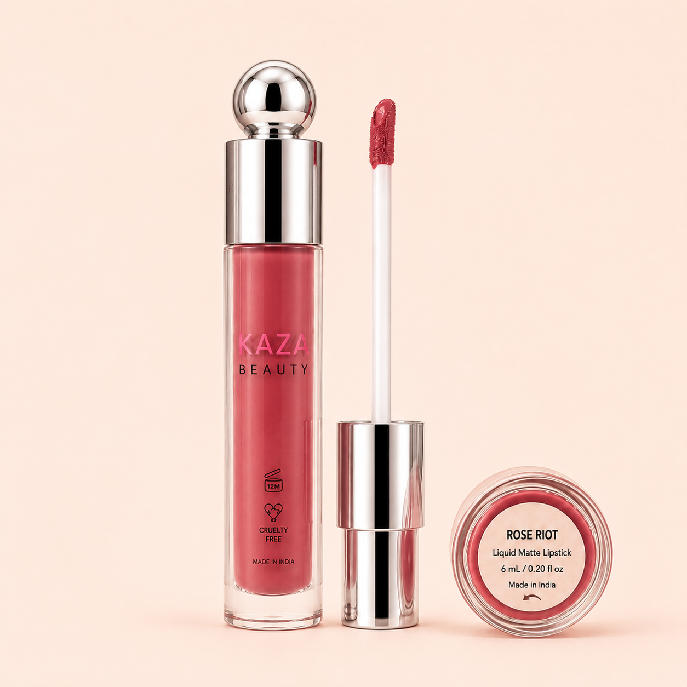

| Field | Value |
|---|---|
| Product ID | `KZ-01` |
| Name on live site | Kaza Beauty Liquid Matte Lipstick |
| Category | Makeup › Lips |
| Site collection(s) | Makeup |
| Price | Rs. 799.00 (Taxes included; shipping calculated at checkout) |
| Status on site (2026-11-09) | **Sold out** |
| Size / net quantity | **6 mL / 0.20 fl oz** — _source: Printed on pack lid label (image 01)_ |
| Shades / options | 6 — Nude Theory, Rose Riot, Mocha Muse, Crimson Code, Plum Obsession, Terracotta Heat |
| Packaging | Clear acrylic tube with chrome dome cap and doe-foot applicator; companion round mini pot with shade-name lid label. |
| Pack & site claims | Vegan, Paraben Free, Cruelty Free, Made in India, Long-wearing, Weightless matte finish |
| Key ingredients | Not listed on site or pack |
| Live URL | <https://kaza-beauty.com/products/kaza-beauty-liquid-matte-lipstick> |
| Shopify product ID / handle | `9669993300209` / `kaza-beauty-liquid-matte-lipstick` |
| Product folder | `products/makeup/KZ-01_liquid-matte-lipstick/` |

**Description (verbatim from live site):**

> Achieve flawless color with Kaza Beauty Liquid Matte Lipstick. This long-wearing formula delivers rich, vibrant pigment in a weightless matte finish that stays put for hours. The smooth application glides effortlessly across lips, providing even coverage without drying or cracking. Perfect for any occasion, from everyday wear to bold statement looks. Available in a range of stunning shades to complement every skin tone. Transform your lip game with professional-quality color that lasts.

**Other marketing copy:** "Matte perfection" (campaign image 08) · Featured product block on homepage

**Shades / variants**

| # | Shade (clean name) | Name on site | Name on pack / shade card | Colour description | Price | Available | Shade image |
|---|---|---|---|---|---|---|---|
| 1 | **Nude Theory** | Nude Theory | 01 Nude Theory | Soft pink-beige nude | Rs. 799 | No (sold out) | [kaza_liquid-matte-lipstick_03_shade-packshot_nude-theory.jpg](products/makeup/KZ-01_liquid-matte-lipstick/images/kaza_liquid-matte-lipstick_03_shade-packshot_nude-theory.jpg) |
| 2 | **Rose Riot** | Rose Riot | 02 Rose Riot | Rosy mid pink | Rs. 799 | No (sold out) | [kaza_liquid-matte-lipstick_01_hero-packshot_rose-riot.png](products/makeup/KZ-01_liquid-matte-lipstick/images/kaza_liquid-matte-lipstick_01_hero-packshot_rose-riot.png) |
| 3 | **Mocha Muse** | Mocha Muse | 03 Mocha Muse | Warm brown mocha nude | Rs. 799 | No (sold out) | [kaza_liquid-matte-lipstick_04_shade-packshot_mocha-muse.jpg](products/makeup/KZ-01_liquid-matte-lipstick/images/kaza_liquid-matte-lipstick_04_shade-packshot_mocha-muse.jpg) |
| 4 | **Crimson Code** | Crimson Code | 04 Crimson Code | Deep classic red | Rs. 799 | No (sold out) | [kaza_liquid-matte-lipstick_05_shade-packshot_crimson-code.jpg](products/makeup/KZ-01_liquid-matte-lipstick/images/kaza_liquid-matte-lipstick_05_shade-packshot_crimson-code.jpg) |
| 5 | **Plum Obsession** | Plum obsession | 05 Plum Obsession | Deep berry plum | Rs. 799 | No (sold out) | [kaza_liquid-matte-lipstick_06_shade-packshot_plum-obsession.jpg](products/makeup/KZ-01_liquid-matte-lipstick/images/kaza_liquid-matte-lipstick_06_shade-packshot_plum-obsession.jpg) |
| 6 | **Terracotta Heat** | Terracota Heat | 06 Terracotta Heat | Burnt orange terracotta | Rs. 799 | No (sold out) | [kaza_liquid-matte-lipstick_07_shade-packshot_terracotta-heat.jpg](products/makeup/KZ-01_liquid-matte-lipstick/images/kaza_liquid-matte-lipstick_07_shade-packshot_terracotta-heat.jpg) |

**Images**

| # | Role | Shade | What it shows | File | Size (px) |
|---|---|---|---|---|---|
| 01 | hero-packshot | Rose Riot | Hero packshot: Rose Riot tube, applicator and labelled mini pot on pale peach background. | [kaza_liquid-matte-lipstick_01_hero-packshot_rose-riot.png](products/makeup/KZ-01_liquid-matte-lipstick/images/kaza_liquid-matte-lipstick_01_hero-packshot_rose-riot.png) | 1254×1254 |
| 02 | shade-card | — | SHADE SHEET: all 6 shades (01 Nude Theory, 02 Rose Riot, 03 Mocha Muse, 04 Crimson Code, 05 Plum Obsession, 06 Terracotta Heat) with lip swatch + arm swatch; footer icons Vegan / Paraben Free / Cruelty Free / Made in India. | [kaza_liquid-matte-lipstick_02_shade-card.png](products/makeup/KZ-01_liquid-matte-lipstick/images/kaza_liquid-matte-lipstick_02_shade-card.png) | 1080×1080 |
| 03 | shade-packshot | Nude Theory | Shade packshot: Nude Theory tube, applicator and mini pot. | [kaza_liquid-matte-lipstick_03_shade-packshot_nude-theory.jpg](products/makeup/KZ-01_liquid-matte-lipstick/images/kaza_liquid-matte-lipstick_03_shade-packshot_nude-theory.jpg) | 1536×1536 |
| 04 | shade-packshot | Mocha Muse | Shade packshot: Mocha Muse tube, applicator and mini pot. | [kaza_liquid-matte-lipstick_04_shade-packshot_mocha-muse.jpg](products/makeup/KZ-01_liquid-matte-lipstick/images/kaza_liquid-matte-lipstick_04_shade-packshot_mocha-muse.jpg) | 2048×2048 |
| 05 | shade-packshot | Crimson Code | Shade packshot: Crimson Code tube, applicator and mini pot. | [kaza_liquid-matte-lipstick_05_shade-packshot_crimson-code.jpg](products/makeup/KZ-01_liquid-matte-lipstick/images/kaza_liquid-matte-lipstick_05_shade-packshot_crimson-code.jpg) | 2048×2048 |
| 06 | shade-packshot | Plum Obsession | Shade packshot: Plum Obsession tube, applicator and mini pot. | [kaza_liquid-matte-lipstick_06_shade-packshot_plum-obsession.jpg](products/makeup/KZ-01_liquid-matte-lipstick/images/kaza_liquid-matte-lipstick_06_shade-packshot_plum-obsession.jpg) | 2048×2048 |
| 07 | shade-packshot | Terracotta Heat | Shade packshot: Terracotta Heat tube, applicator and mini pot. | [kaza_liquid-matte-lipstick_07_shade-packshot_terracotta-heat.jpg](products/makeup/KZ-01_liquid-matte-lipstick/images/kaza_liquid-matte-lipstick_07_shade-packshot_terracotta-heat.jpg) | 2048×2048 |
| 08 | model-lifestyle | Rose Riot | Campaign: model holding the lipstick beside her face, text overlay "Matte perfection". | [kaza_liquid-matte-lipstick_08_model-lifestyle_rose-riot.png](products/makeup/KZ-01_liquid-matte-lipstick/images/kaza_liquid-matte-lipstick_08_model-lifestyle_rose-riot.png) | 1080×1080 |

---

### KZ-02 · Kaza Beauty Lip Gloss

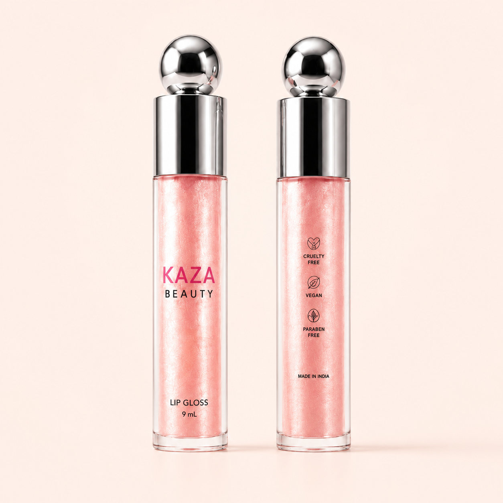

| Field | Value |
|---|---|
| Product ID | `KZ-02` |
| Name on live site | Kaza Beauty Lip Gloss |
| Category | Makeup › Lips |
| Site collection(s) | Makeup |
| Price | Rs. 699.00 (Taxes included; shipping calculated at checkout) |
| Status on site (2026-11-09) | **Sold out** |
| Size / net quantity | **9 mL** — _source: Printed on tube (image 01)_ |
| Shades / options | 4 — Clear Glass, Blush Frequency, Caramel Drip, Berry Glaze |
| Packaging | Clear tube with chrome collar and chrome sphere cap; front/back pair shown (back lists Cruelty Free / Vegan / Paraben Free / Made in India). |
| Pack & site claims | Cruelty Free, Vegan, Paraben Free, Made in India, High-shine, Non-sticky |
| Key ingredients | Not listed on site or pack |
| Live URL | <https://kaza-beauty.com/products/kaza-beauty-lip-gloss> |
| Shopify product ID / handle | `9670028067057` / `kaza-beauty-lip-gloss` |
| Product folder | `products/makeup/KZ-02_lip-gloss/` |

**Description (verbatim from live site):**

> Kaza Beauty Lip Gloss delivers a lustrous, high-shine finish that enhances your natural lip color. Formulated with nourishing ingredients, this lightweight gloss glides on smoothly without stickiness, providing all-day comfort and radiance. Perfect for everyday wear or special occasions, it adds dimension and glamour to any makeup look. Available in multiple shades to complement every skin tone.

**Other marketing copy:** Homepage: "Our signature product - Kaza Beauty Lip Gloss delivers a smooth, non-sticky shine with a soft wash of colour, leaving lips looking fuller, hydrated and beautifully glossy."

**Shades / variants**

| # | Shade (clean name) | Name on site | Name on pack / shade card | Colour description | Price | Available | Shade image |
|---|---|---|---|---|---|---|---|
| 1 | **Clear Glass** | Clear Glass | 01 Glass Affair (Clear Gloss) | Clear gloss | Rs. 699 | No (sold out) | [kaza_lip-gloss_03_shade-packshot_clear-glass.jpg](products/makeup/KZ-02_lip-gloss/images/kaza_lip-gloss_03_shade-packshot_clear-glass.jpg) |
| 2 | **Blush Frequency** | Blush Frequency | 02 Blush Frequency (Soft Pink Gloss) | Soft pink gloss with shimmer | Rs. 699 | No (sold out) | [kaza_lip-gloss_01_hero-packshot_blush-frequency.png](products/makeup/KZ-02_lip-gloss/images/kaza_lip-gloss_01_hero-packshot_blush-frequency.png) |
| 3 | **Caramel Drip** | Caramel Drip | 03 Caramel Drip (Caramel Nude Gloss) | Caramel nude gloss | Rs. 699 | No (sold out) | [kaza_lip-gloss_04_shade-packshot_caramel-drip.jpg](products/makeup/KZ-02_lip-gloss/images/kaza_lip-gloss_04_shade-packshot_caramel-drip.jpg) |
| 4 | **Berry Glaze** | Berry Glaze | 04 Berry Glaze (Berry Tint Gloss) | Berry tint gloss | Rs. 699 | No (sold out) | [kaza_lip-gloss_05_shade-packshot_berry-glaze.jpg](products/makeup/KZ-02_lip-gloss/images/kaza_lip-gloss_05_shade-packshot_berry-glaze.jpg) |

**Images**

| # | Role | Shade | What it shows | File | Size (px) |
|---|---|---|---|---|---|
| 01 | hero-packshot | Blush Frequency | Hero packshot: Blush Frequency (shimmery pink) front + back tubes. | [kaza_lip-gloss_01_hero-packshot_blush-frequency.png](products/makeup/KZ-02_lip-gloss/images/kaza_lip-gloss_01_hero-packshot_blush-frequency.png) | 1254×1254 |
| 02 | shade-card | — | SHADE CARD "4 Stunning Shades": 01 Glass Affair (Clear Gloss), 02 Blush Frequency (Soft Pink Gloss), 03 Caramel Drip (Caramel Nude Gloss), 04 Berry Glaze (Berry Tint Gloss) with lip + swatch. | [kaza_lip-gloss_02_shade-card.jpg](products/makeup/KZ-02_lip-gloss/images/kaza_lip-gloss_02_shade-card.jpg) | 2048×2048 |
| 03 | shade-packshot | Clear Glass | Shade packshot: clear gloss front + back tubes (file named "Glass affair"). | [kaza_lip-gloss_03_shade-packshot_clear-glass.jpg](products/makeup/KZ-02_lip-gloss/images/kaza_lip-gloss_03_shade-packshot_clear-glass.jpg) | 2048×2048 |
| 04 | shade-packshot | Caramel Drip | Shade packshot: Caramel Drip front + back tubes. | [kaza_lip-gloss_04_shade-packshot_caramel-drip.jpg](products/makeup/KZ-02_lip-gloss/images/kaza_lip-gloss_04_shade-packshot_caramel-drip.jpg) | 2048×2048 |
| 05 | shade-packshot | Berry Glaze | Shade packshot: Berry Glaze front + back tubes. | [kaza_lip-gloss_05_shade-packshot_berry-glaze.jpg](products/makeup/KZ-02_lip-gloss/images/kaza_lip-gloss_05_shade-packshot_berry-glaze.jpg) | 2048×2048 |

---

### KZ-03 · Kaza Beauty Lip Oil

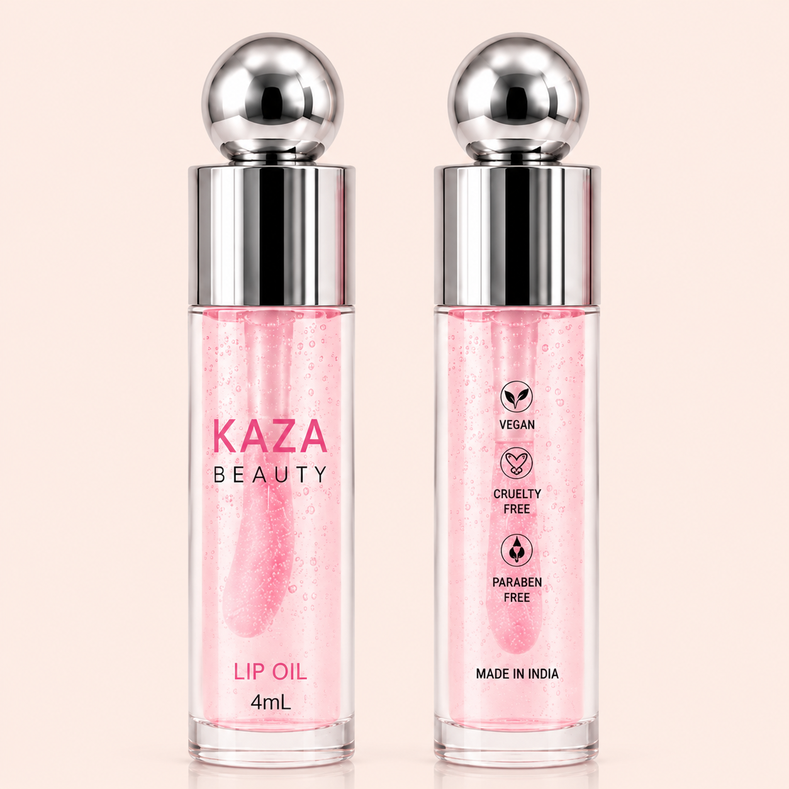

| Field | Value |
|---|---|
| Product ID | `KZ-03` |
| Name on live site | Kaza Beauty Lip Oil |
| Category | Makeup › Lips |
| Site collection(s) | Makeup |
| Price | Rs. 599.00 (Taxes included; shipping calculated at checkout) |
| Status on site (2026-11-09) | **Sold out** |
| Size / net quantity | **4 mL** — _source: Printed on bottle (image 01)_ |
| Shades / options | 4 — Glazed Clear, Pink Cloud, Peach Glow, Secret Flush |
| Packaging | Clear bottle with chrome collar and chrome sphere cap, KAZA BEAUTY in pink; back lists Vegan / Cruelty Free / Paraben Free / Made in India. |
| Pack & site claims | Vegan, Cruelty Free, Paraben Free, Made in India, Non-sticky, Glass-like shine |
| Key ingredients | Not listed on site or pack |
| Live URL | <https://kaza-beauty.com/products/kaza-beauty-lip-oil> |
| Shopify product ID / handle | `9671644315889` / `kaza-beauty-lip-oil` |
| Product folder | `products/makeup/KZ-03_lip-oil/` |

**Description (verbatim from live site):**

> Kaza Beauty Lip Oil is a lightweight, non-sticky formula that deeply nourishes and hydrates dry lips while delivering a smooth, glass-like shine. Its soft pink texture leaves lips feeling comfortable, supple and naturally glossy—perfect for everyday wear alone or over lipstick.

**Shades / variants**

| # | Shade (clean name) | Name on site | Name on pack / shade card | Colour description | Price | Available | Shade image |
|---|---|---|---|---|---|---|---|
| 1 | **Glazed Clear** | Glazed Clear | 01 Glazed Clear (Clear Oil) | Clear oil | Rs. 599 | No (sold out) | [kaza_lip-oil_03_shade-packshot_glazed-clear.jpg](products/makeup/KZ-03_lip-oil/images/kaza_lip-oil_03_shade-packshot_glazed-clear.jpg) |
| 2 | **Pink Cloud** | Pink Cloud | 02 Pink Cloud (Soft Pink Tint) | Soft pink tint | Rs. 599 | No (sold out) | [kaza_lip-oil_01_hero-packshot_pink-cloud.png](products/makeup/KZ-03_lip-oil/images/kaza_lip-oil_01_hero-packshot_pink-cloud.png) |
| 3 | **Peach Glow** | Peach Glow | 03 Peach Glow (Peach Tint) | Peach tint | Rs. 599 | No (sold out) | [kaza_lip-oil_04_shade-packshot_peach-glow.jpg](products/makeup/KZ-03_lip-oil/images/kaza_lip-oil_04_shade-packshot_peach-glow.jpg) |
| 4 | **Secret Flush** | Secret Flush | 04 Secret Flush (pH Reactive Tint) | pH-reactive berry-pink tint | Rs. 599 | No (sold out) | [kaza_lip-oil_05_shade-packshot_secret-flush.jpg](products/makeup/KZ-03_lip-oil/images/kaza_lip-oil_05_shade-packshot_secret-flush.jpg) |

**Images**

| # | Role | Shade | What it shows | File | Size (px) |
|---|---|---|---|---|---|
| 01 | hero-packshot | Pink Cloud | Hero packshot: Pink Cloud front + back bottles. | [kaza_lip-oil_01_hero-packshot_pink-cloud.png](products/makeup/KZ-03_lip-oil/images/kaza_lip-oil_01_hero-packshot_pink-cloud.png) | 1254×1254 |
| 02 | shade-card | — | SHADE SHEET "4 Stunning Shades": 01 Glazed Clear (Clear Oil), 02 Pink Cloud (Soft Pink Tint), 03 Peach Glow (Peach Tint), 04 Secret Flush (pH Reactive Tint) with lip + swatch. | [kaza_lip-oil_02_shade-card.jpg](products/makeup/KZ-03_lip-oil/images/kaza_lip-oil_02_shade-card.jpg) | 2400×1792 |
| 03 | shade-packshot | Glazed Clear | Shade packshot: Glazed Clear front + back bottles. | [kaza_lip-oil_03_shade-packshot_glazed-clear.jpg](products/makeup/KZ-03_lip-oil/images/kaza_lip-oil_03_shade-packshot_glazed-clear.jpg) | 2400×1792 |
| 04 | shade-packshot | Peach Glow | Shade packshot: Peach Glow front + back bottles. | [kaza_lip-oil_04_shade-packshot_peach-glow.jpg](products/makeup/KZ-03_lip-oil/images/kaza_lip-oil_04_shade-packshot_peach-glow.jpg) | 2400×1792 |
| 05 | shade-packshot | Secret Flush | Shade packshot: Secret Flush front + back bottles. | [kaza_lip-oil_05_shade-packshot_secret-flush.jpg](products/makeup/KZ-03_lip-oil/images/kaza_lip-oil_05_shade-packshot_secret-flush.jpg) | 2400×1792 |

---

### KZ-04 · Kaza Beauty Lip & Cheek Tint

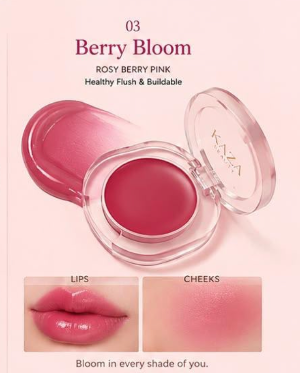

| Field | Value |
|---|---|
| Product ID | `KZ-04` |
| Name on live site | Kaza beauty Lip and Cheek tint |
| Category | Makeup › Lips & Cheeks |
| Site collection(s) | Makeup |
| Price | Rs. 899.00 (Taxes included; shipping calculated at checkout) |
| Status on site (2026-11-09) | **Sold out** |
| Size / net quantity | **Not stated** — _source: Not stated on site or visible on pack_ |
| Shades / options | 3 — Bare Bloom (Clear), Peach Kiss, Berry Glaze |
| Packaging | Clear acrylic round pot with clear lid, KAZA embossed on lid. |
| Pack & site claims | Multi-use: lips + cheeks, Buildable, Dewy finish |
| Key ingredients | Not listed on site or pack |
| Live URL | <https://kaza-beauty.com/products/kaza-beauty-cream-blush> |
| Shopify product ID / handle | `9670211764465` / `kaza-beauty-cream-blush` |
| Product folder | `products/makeup/KZ-04_lip-and-cheek-tint/` |

**Description (verbatim from live site):**

> Elevate your complexion with Kaza Beauty's luxurious Cream Blush. This silky, blendable formula delivers a natural flush of color that seamlessly melts into skin for a radiant, dewy finish. Perfect for all skin tones, it layers beautifully and lasts throughout the day. Whether you prefer a subtle glow or a bold pop of color, this

**Other marketing copy:** Featured product block on homepage · Shade-card taglines: "Bloom in every shade of you." / "Soft as a peach, fresh all day." / "Your lips, your unique pink."

**Shades / variants**

| # | Shade (clean name) | Name on site | Name on pack / shade card | Colour description | Price | Available | Shade image |
|---|---|---|---|---|---|---|---|
| 1 | **Bare Bloom (Clear)** | Bare Bloom (clear) | 01 Bloom pH - pH Colour Changing, Clear Gel -> Custom Pink | Clear gel that turns a personalised pink (pH reactive) | Rs. 899 | No (sold out) | [kaza_lip-and-cheek-tint_03_shade-card_bare-bloom-clear.png](products/makeup/KZ-04_lip-and-cheek-tint/images/kaza_lip-and-cheek-tint_03_shade-card_bare-bloom-clear.png) _(matched by content)_ |
| 2 | **Peach Kiss** | peach kiss | 02 Peach Kiss - Soft Peach Coral, Fresh & Natural Flush | Soft peach coral | Rs. 899 | No (sold out) | [kaza_lip-and-cheek-tint_02_shade-card_peach-kiss.png](products/makeup/KZ-04_lip-and-cheek-tint/images/kaza_lip-and-cheek-tint_02_shade-card_peach-kiss.png) _(matched by content)_ |
| 3 | **Berry Glaze** | Berry Glaze | 03 Berry Bloom - Rosy Berry Pink, Healthy Flush & Buildable | Rosy berry pink | Rs. 899 | No (sold out) | [kaza_lip-and-cheek-tint_01_shade-card_berry-glaze.png](products/makeup/KZ-04_lip-and-cheek-tint/images/kaza_lip-and-cheek-tint_01_shade-card_berry-glaze.png) _(matched by content)_ |

**Images**

| # | Role | Shade | What it shows | File | Size (px) |
|---|---|---|---|---|---|
| 01 | shade-card | Berry Glaze | Shade card "03 Berry Bloom - Rosy Berry Pink, Healthy Flush & Buildable" with LIPS + CHEEKS swatches; tagline "Bloom in every shade of you." (site variant name: Berry Glaze). Low-res screenshot. | [kaza_lip-and-cheek-tint_01_shade-card_berry-glaze.png](products/makeup/KZ-04_lip-and-cheek-tint/images/kaza_lip-and-cheek-tint_01_shade-card_berry-glaze.png) | 606×752 |
| 02 | shade-card | Peach Kiss | Shade card "02 Peach Kiss - Soft Peach Coral, Fresh & Natural Flush" with LIPS + CHEEKS swatches; tagline "Soft as a peach, fresh all day." Low-res screenshot. | [kaza_lip-and-cheek-tint_02_shade-card_peach-kiss.png](products/makeup/KZ-04_lip-and-cheek-tint/images/kaza_lip-and-cheek-tint_02_shade-card_peach-kiss.png) | 604×710 |
| 03 | shade-card | Bare Bloom (Clear) | Shade card "01 Bloom pH - pH Colour Changing, Clear Gel -> Custom Pink" (pot with flower inclusion) with LIPS + CHEEKS swatches; tagline "Your lips, your unique pink." (site variant name: Bare Bloom (clear)). Low-res screenshot. | [kaza_lip-and-cheek-tint_03_shade-card_bare-bloom-clear.png](products/makeup/KZ-04_lip-and-cheek-tint/images/kaza_lip-and-cheek-tint_03_shade-card_bare-bloom-clear.png) | 568×816 |

---

### KZ-05 · Kaza Beauty Blush Stick

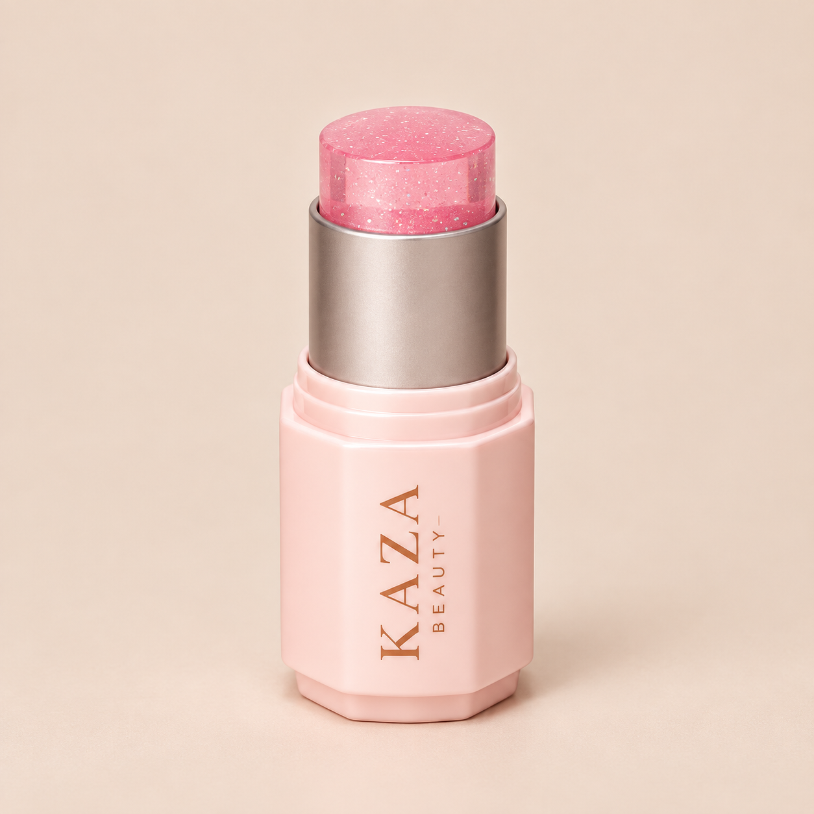

| Field | Value |
|---|---|
| Product ID | `KZ-05` |
| Name on live site | Kaza Beauty Blush Stick |
| Category | Makeup › Cheeks |
| Site collection(s) | (none) |
| Price | Rs. 788.00 (Taxes included; shipping calculated at checkout) |
| Status on site (2026-11-09) | **Sold out** |
| Size / net quantity | **Not stated** — _source: Not stated on site or visible on pack_ |
| Shades / options | 1 — Single variant (colours unnamed) |
| Packaging | Blush-pink octagonal stick with brushed-silver inner collar, vertical KAZA BEAUTY in rose gold. |
| Pack & site claims | — |
| Key ingredients | Not listed on site or pack |
| Live URL | <https://kaza-beauty.com/products/kaza-beauty-blush-stick> |
| Shopify product ID / handle | `10303179161841` / `kaza-beauty-blush-stick` |
| Product folder | `products/makeup/KZ-05_blush-stick/` |

> Colours visible in images but **not named or sold as separate shades**: Pink shimmer, Berry, Bronze terracotta, Coral peach, Dusty rose.

**Description (verbatim from live site):**

> _(No description on the live site.)_

**Shades / variants**

| # | Shade (clean name) | Name on site | Name on pack / shade card | Colour description | Price | Available | Shade image |
|---|---|---|---|---|---|---|---|
| 1 | **Single variant (colours unnamed)** | Default Title | - | Sold as ONE variant; 5 different colours appear in images but are not named or selectable | Rs. 788 | No (sold out) | — |

**Images**

| # | Role | Shade | What it shows | File | Size (px) |
|---|---|---|---|---|---|
| 01 | shade-packshot | Unnamed - Pink Shimmer | Packshot: light pink shimmer bullet (shade not named on site). | [kaza_blush-stick_01_shade-packshot_unnamed-pink-shimmer.png](products/makeup/KZ-05_blush-stick/images/kaza_blush-stick_01_shade-packshot_unnamed-pink-shimmer.png) | 1254×1254 |
| 02 | shade-packshot | Unnamed - Berry | Packshot: berry/raspberry bullet (shade not named on site). | [kaza_blush-stick_02_shade-packshot_unnamed-berry.png](products/makeup/KZ-05_blush-stick/images/kaza_blush-stick_02_shade-packshot_unnamed-berry.png) | 1254×1254 |
| 03 | shade-packshot | Unnamed - Bronze Terracotta | Packshot: bronze terracotta bullet (shade not named on site). | [kaza_blush-stick_03_shade-packshot_unnamed-bronze-terracotta.png](products/makeup/KZ-05_blush-stick/images/kaza_blush-stick_03_shade-packshot_unnamed-bronze-terracotta.png) | 1254×1254 |
| 04 | shade-packshot | Unnamed - Coral Peach | Packshot: coral peach bullet (shade not named on site). | [kaza_blush-stick_04_shade-packshot_unnamed-coral-peach.png](products/makeup/KZ-05_blush-stick/images/kaza_blush-stick_04_shade-packshot_unnamed-coral-peach.png) | 1254×1254 |
| 05 | shade-packshot | Unnamed - Dusty Rose | Packshot: dusty rose/mauve bullet (shade not named on site). | [kaza_blush-stick_05_shade-packshot_unnamed-dusty-rose.png](products/makeup/KZ-05_blush-stick/images/kaza_blush-stick_05_shade-packshot_unnamed-dusty-rose.png) | 1254×1254 |

---

### KZ-06 · Kaza Beauty Cushion Foundation

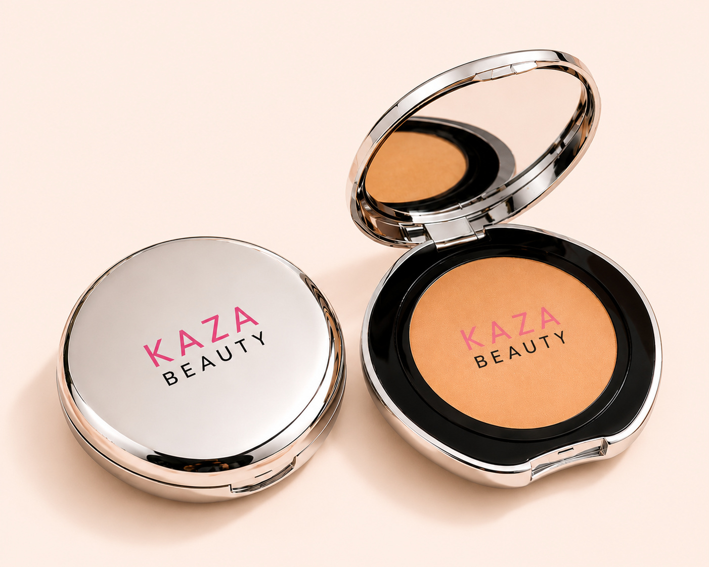

| Field | Value |
|---|---|
| Product ID | `KZ-06` |
| Name on live site | Kaza  Cushion Foundation |
| Category | Makeup › Face / Complexion |
| Site collection(s) | Makeup |
| Price | Rs. 1,099.00 (Taxes included; shipping calculated at checkout) |
| Status on site (2026-11-09) | **Sold out** |
| Size / net quantity | **Not stated** — _source: Not stated on site or visible on pack_ |
| Shades / options | 4 — Pearl Veil, Ivory Silk, Cashmere Beige, Warm Nude |
| Packaging | Round chrome compact with mirror lid, black inner pan ring, KAZA BEAUTY in pink on lid and pressed into product. |
| Pack & site claims | Buildable coverage, For all skin tones and types (per site copy) |
| Key ingredients | Not listed on site or pack |
| Live URL | <https://kaza-beauty.com/products/kaza-beauty-compact> |
| Shopify product ID / handle | `9669987238129` / `kaza-beauty-compact` |
| Product folder | `products/makeup/KZ-06_cushion-foundation/` |

**Description (verbatim from live site):**

> Achieve a sculpted, defined look with Kaza Beauty Compact. This versatile contour powder blends seamlessly into skin, creating natural shadows and dimension. Perfect for contouring, bronzing, or subtle shading, it delivers buildable coverage with a smooth, long-lasting finish. Ideal for all skin tones and types.

**Shades / variants**

| # | Shade (clean name) | Name on site | Name on pack / shade card | Colour description | Price | Available | Shade image |
|---|---|---|---|---|---|---|---|
| 1 | **Pearl Veil** | Pearl Viel | - | Lightest - fair ivory (image file named "Ivory silk") | Rs. 1,099 | No (sold out) | [kaza_cushion-foundation_02_shade-packshot_pearl-veil.jpg](products/makeup/KZ-06_cushion-foundation/images/kaza_cushion-foundation_02_shade-packshot_pearl-veil.jpg) |
| 2 | **Ivory Silk** | Ivory Silk | - | Light beige (image file named "Vanilla Beige") | Rs. 1,099 | No (sold out) | [kaza_cushion-foundation_03_shade-packshot_ivory-silk.jpg](products/makeup/KZ-06_cushion-foundation/images/kaza_cushion-foundation_03_shade-packshot_ivory-silk.jpg) |
| 3 | **Cashmere Beige** | Cashmere Beige | - | Medium golden beige | Rs. 1,099 | No (sold out) | [kaza_cushion-foundation_01_hero-packshot_cashmere-beige.png](products/makeup/KZ-06_cushion-foundation/images/kaza_cushion-foundation_01_hero-packshot_cashmere-beige.png) |
| 4 | **Warm Nude** | Warm nude | - | Tan / warm sand (image file named "warm sand") | Rs. 1,099 | No (sold out) | [kaza_cushion-foundation_04_shade-packshot_warm-nude.jpg](products/makeup/KZ-06_cushion-foundation/images/kaza_cushion-foundation_04_shade-packshot_warm-nude.jpg) |

**Images**

| # | Role | Shade | What it shows | File | Size (px) |
|---|---|---|---|---|---|
| 01 | hero-packshot | Cashmere Beige | Hero packshot: closed + open compact, medium golden shade. | [kaza_cushion-foundation_01_hero-packshot_cashmere-beige.png](products/makeup/KZ-06_cushion-foundation/images/kaza_cushion-foundation_01_hero-packshot_cashmere-beige.png) | 1402×1122 |
| 02 | shade-packshot | Pearl Veil | Shade packshot: open + closed compact with powder swatch, lightest shade (file name "Ivory silk"). | [kaza_cushion-foundation_02_shade-packshot_pearl-veil.jpg](products/makeup/KZ-06_cushion-foundation/images/kaza_cushion-foundation_02_shade-packshot_pearl-veil.jpg) | 2048×2048 |
| 03 | shade-packshot | Ivory Silk | Shade packshot: closed + open compact, light beige (file name "Vanilla Beige"). | [kaza_cushion-foundation_03_shade-packshot_ivory-silk.jpg](products/makeup/KZ-06_cushion-foundation/images/kaza_cushion-foundation_03_shade-packshot_ivory-silk.jpg) | 2048×2048 |
| 04 | shade-packshot | Warm Nude | Shade packshot: closed + open compact, tan/warm shade (file name "warm sand"). | [kaza_cushion-foundation_04_shade-packshot_warm-nude.jpg](products/makeup/KZ-06_cushion-foundation/images/kaza_cushion-foundation_04_shade-packshot_warm-nude.jpg) | 2048×2048 |

---

### KZ-07 · Kaza Beauty Kajal - Midnight Muse

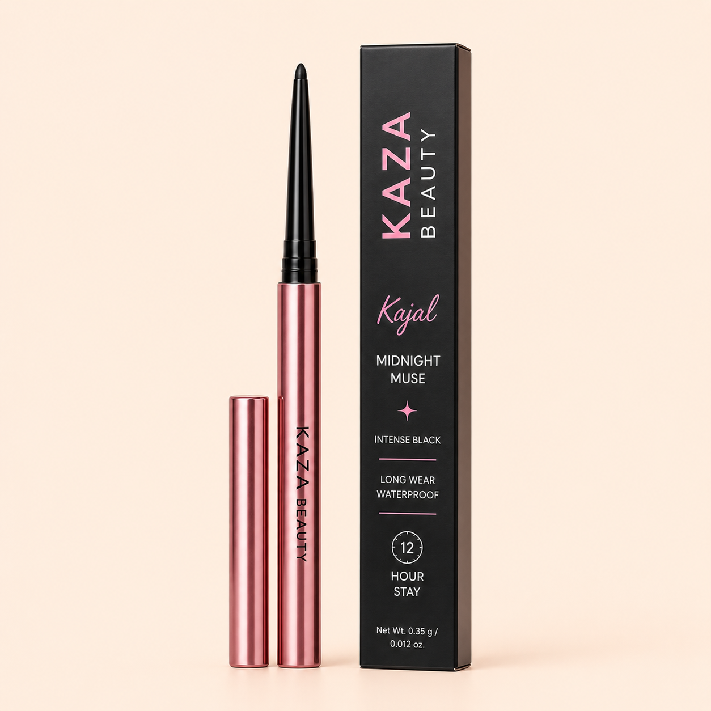

| Field | Value |
|---|---|
| Product ID | `KZ-07` |
| Name on live site | Kaza Beauty Kajal |
| Category | Makeup › Eyes |
| Site collection(s) | Home page (featured), Makeup |
| Price | Rs. 499.00 (Taxes included; shipping calculated at checkout) |
| Status on site (2026-11-09) | **Sold out** |
| Size / net quantity | **Net Wt. 0.35 g / 0.012 oz** — _source: Printed on carton (image 01)_ |
| Shades / options | 1 — Midnight Muse (Intense Black) |
| Packaging | Rose-gold retractable pencil with cap; matte black carton with pink KAZA BEAUTY and script "Kajal". |
| Pack & site claims | Intense Black, Long Wear, Waterproof, 12 Hour Stay, Smudge-proof (site copy) |
| Key ingredients | Not listed on site or pack |
| Live URL | <https://kaza-beauty.com/products/kaza-beauty-kajal-midnight-muse-kajal> |
| Shopify product ID / handle | `9669977178353` / `kaza-beauty-kajal-midnight-muse-kajal` |
| Product folder | `products/makeup/KZ-07_kajal/` |

> Extra shade shown in images but **not sold**: Brown Muse - Rich Brown (image 02; NOT sold as a variant).

**Description (verbatim from live site):**

> Kaza Beauty Kajal Midnight Muse delivers intense, long-lasting color that defines your eyes with precision. This smooth, creamy kajal glides effortlessly along the lash line and waterline, creating bold definition that lasts all day and night. The rich midnight shade complements all skin tones, adding depth and drama to your gaze. Perfect for everyday wear or special occasions, this kajal combines comfort with stunning results. Easy to apply and smudge-proof, it's your go-to for captivating eyes.

**Other marketing copy:** Homepage featured product · Campaign: model biting the kajal pencil (homepage hero)

**Shades / variants**

| # | Shade (clean name) | Name on site | Name on pack / shade card | Colour description | Price | Available | Shade image |
|---|---|---|---|---|---|---|---|
| 1 | **Midnight Muse (Intense Black)** | Default Title | Midnight Muse - Intense Black | Intense black | Rs. 499 | No (sold out) | — |

**Images**

| # | Role | Shade | What it shows | File | Size (px) |
|---|---|---|---|---|---|
| 01 | hero-packshot | Midnight Muse | Hero packshot: Midnight Muse (Intense Black) pencil + cap + carton: Long Wear Waterproof, 12 Hour Stay, Net Wt. 0.35 g / 0.012 oz. | [kaza_kajal_01_hero-packshot_midnight-muse.png](products/makeup/KZ-07_kajal/images/kaza_kajal_01_hero-packshot_midnight-muse.png) | 1254×1254 |
| 02 | shade-packshot | Brown Muse | Packshot: Brown Muse (Rich Brown) pencil + carton - shade shown but not offered as a variant. | [kaza_kajal_02_shade-packshot_brown-muse.png](products/makeup/KZ-07_kajal/images/kaza_kajal_02_shade-packshot_brown-muse.png) | 1254×1254 |
| 03 | before-after | — | Before / After model: graphic winged black kajal look. | [kaza_kajal_03_before-after.jpg](products/makeup/KZ-07_kajal/images/kaza_kajal_03_before-after.jpg) | 2048×2048 |
| 04 | before-after | — | Before / After model: soft smudged brown kajal look. | [kaza_kajal_04_before-after.png](products/makeup/KZ-07_kajal/images/kaza_kajal_04_before-after.png) | 1254×1254 |

---

#### Skincare

### KZ-08 · Kaza Beauty Glow C Serum

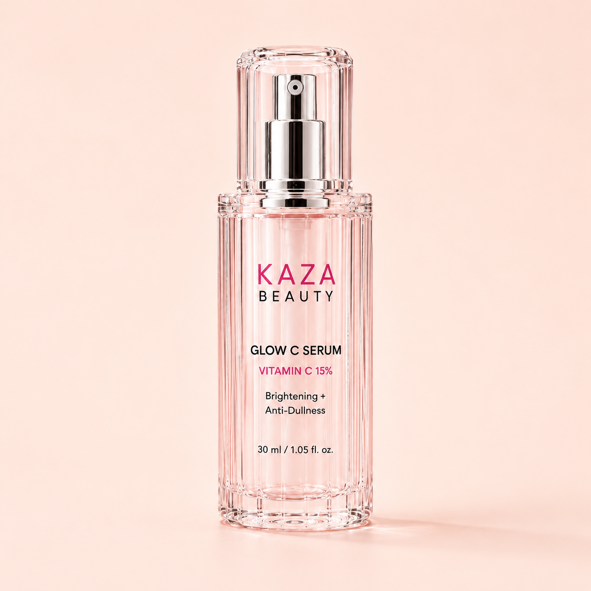

| Field | Value |
|---|---|
| Product ID | `KZ-08` |
| Name on live site | Kaza Beauty Glow C Serum |
| Category | Skincare › Serum |
| Site collection(s) | Skincare |
| Price | Rs. 1,099.00 (Taxes included; shipping calculated at checkout) |
| Status on site (2026-11-09) | **Sold out** |
| Size / net quantity | **30 ml / 1.05 fl oz** — _source: Printed on bottle (images 01, 02)_ |
| Shades / options | 1 — Single variant |
| Packaging | Faceted clear-pink glass bottle with chrome pump and clear overcap. |
| Pack & site claims | Vitamin C 15%, Brightening + Anti-Dullness, Powerful antioxidant, For all skin types, Non-greasy |
| Key ingredients | Vitamin C 15% - brightens & boosts natural glow; Ferulic Acid - enhances antioxidant protection; Hyaluronic Acid - hydrates & plumps skin; Panthenol - soothes & strengthens skin barrier |
| Live URL | <https://kaza-beauty.com/products/kaza-beauty-glow-c-serum> |
| Shopify product ID / handle | `9670009258225` / `kaza-beauty-glow-c-serum` |
| Product folder | `products/skincare/KZ-08_glow-c-serum/` |

**Description (verbatim from live site):**

> Kaza Beauty Glow C Serum is a lightweight, fast-absorbing facial serum formulated to brighten and revitalize your complexion. Enriched with vitamin C and potent antioxidants, this serum helps reduce the appearance of dark spots, uneven skin tone, and fine lines while promoting a radiant, youthful glow. Perfect for all skin types, it absorbs quickly without leaving a greasy residue. Apply a few drops to clean skin each morning and evening for best results. Unlock your skin's natural luminosity with this essential skincare staple.

**Other marketing copy:** "For radiant, glowing skin" · "3 Modes. 3 Glow Benefits." - Brighten / Hydrate / Protect

**Shades / variants**

| # | Shade (clean name) | Name on site | Name on pack / shade card | Colour description | Price | Available | Shade image |
|---|---|---|---|---|---|---|---|
| 1 | **Single variant** | Default Title | - | Single variant | Rs. 1,099 | No (sold out) | — |

**Images**

| # | Role | Shade | What it shows | File | Size (px) |
|---|---|---|---|---|---|
| 01 | hero-packshot | — | Hero packshot: Glow C Serum bottle, Vitamin C 15%, Brightening + Anti-Dullness, 30 ml / 1.05 fl oz. | [kaza_glow-c-serum_01_hero-packshot.png](products/skincare/KZ-08_glow-c-serum/images/kaza_glow-c-serum_01_hero-packshot.png) | 1254×1254 |
| 02 | infographic | — | Infographic: benefits (Brightens Skin, Anti-Dullness, Powerful Antioxidant), key ingredients (Vitamin C 15%, Ferulic Acid, Hyaluronic Acid, Panthenol), "3 Modes: Brighten / Hydrate / Protect". | [kaza_glow-c-serum_02_infographic.png](products/skincare/KZ-08_glow-c-serum/images/kaza_glow-c-serum_02_infographic.png) | 1080×1080 |
| 03 | before-after | — | Before / After model with bottle, "For radiant, glowing skin". | [kaza_glow-c-serum_03_before-after.png](products/skincare/KZ-08_glow-c-serum/images/kaza_glow-c-serum_03_before-after.png) | 1080×1080 |

---

### KZ-09 · Kaza Beauty Clear Code Serum

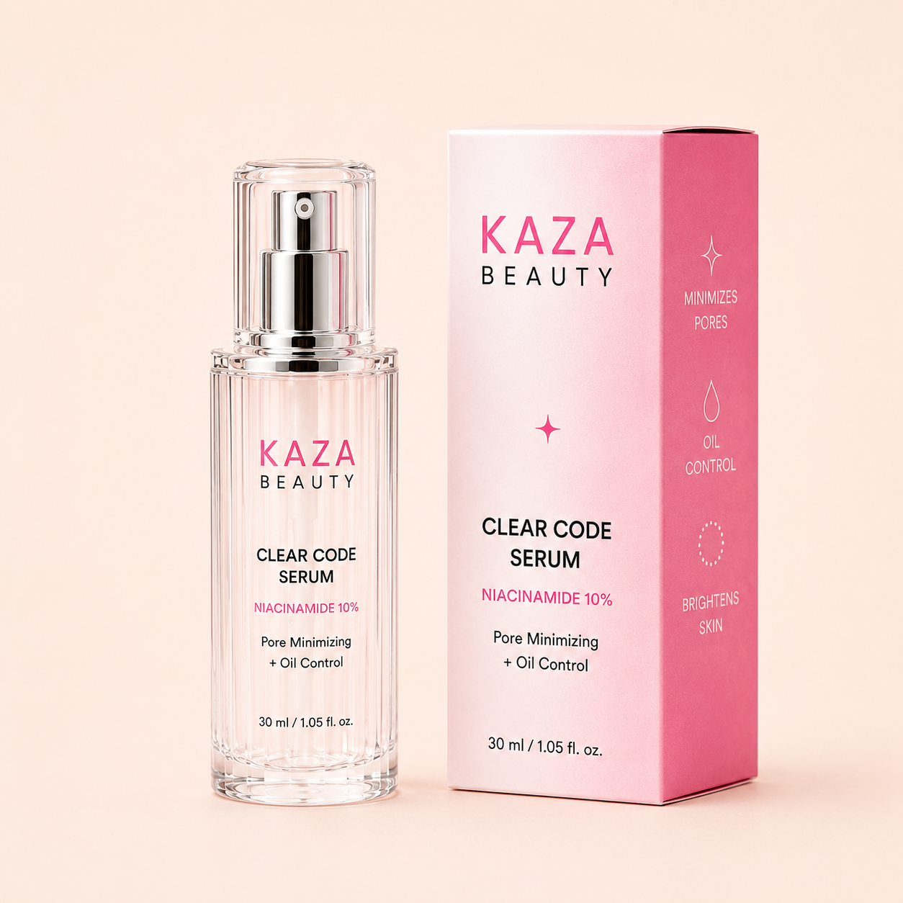

| Field | Value |
|---|---|
| Product ID | `KZ-09` |
| Name on live site | Kaza Beauty Clear code serum |
| Category | Skincare › Serum |
| Site collection(s) | Skincare |
| Price | Rs. 1,299.00 (Taxes included; shipping calculated at checkout) |
| Status on site (2026-11-09) | **Sold out** |
| Size / net quantity | **30 ml / 1.05 fl oz** — _source: Printed on bottle + carton (image 01)_ |
| Shades / options | 1 — Single variant |
| Packaging | Fluted clear bottle with chrome pump and clear overcap; pink gradient carton. |
| Pack & site claims | Niacinamide 10%, Pore Minimizing + Oil Control, Minimizes Pores, Oil Control, Brightens Skin, Lightweight, non-greasy |
| Key ingredients | Niacinamide 10% |
| Live URL | <https://kaza-beauty.com/products/kaza-beauty-lip-gloss-1> |
| Shopify product ID / handle | `9670129942769` / `kaza-beauty-lip-gloss-1` |
| Product folder | `products/skincare/KZ-09_clear-code-serum/` |

**Description (verbatim from live site):**

> Kaza Beauty Clear Code Serum is a lightweight, fast-absorbing niacinamide serum designed to help refine the look of pores, control excess oil and improve uneven-looking skin. Powered by 10% niacinamide, it supports a smoother, clearer and more balanced complexion without leaving the skin sticky or heavy.
> 
> With regular use, the serum helps reduce dullness, improve skin texture and maintain a fresh, shine-controlled finish. Its gentle everyday formula layers easily under moisturiser, sunscreen and makeup.
> 
> Key benefits:Minimises the appearance of pores • Controls excess oil • Brightens dull-looking skin • Smooths uneven texture • Lightweight and non-greasy
> 
> How to use: Apply 2–3 drops to clean, dry skin before moisturiser. Use once or twice daily, followed by sunscreen during the day.

**Other marketing copy:** Homepage slideshow: "Clear Code Serum - Clear pores. Control oil. Reveal your glow."

**Shades / variants**

| # | Shade (clean name) | Name on site | Name on pack / shade card | Colour description | Price | Available | Shade image |
|---|---|---|---|---|---|---|---|
| 1 | **Single variant** | Default Title | - | Single variant | Rs. 1,299 | No (sold out) | — |

**Images**

| # | Role | Shade | What it shows | File | Size (px) |
|---|---|---|---|---|---|
| 01 | hero-packshot | — | Hero packshot: bottle + carton, Niacinamide 10%, Pore Minimizing + Oil Control, 30 ml / 1.05 fl oz. | [kaza_clear-code-serum_01_hero-packshot.png](products/skincare/KZ-09_clear-code-serum/images/kaza_clear-code-serum_01_hero-packshot.png) | 1254×1254 |

---

### KZ-10 · Kaza Beauty Lumi Veil Cream

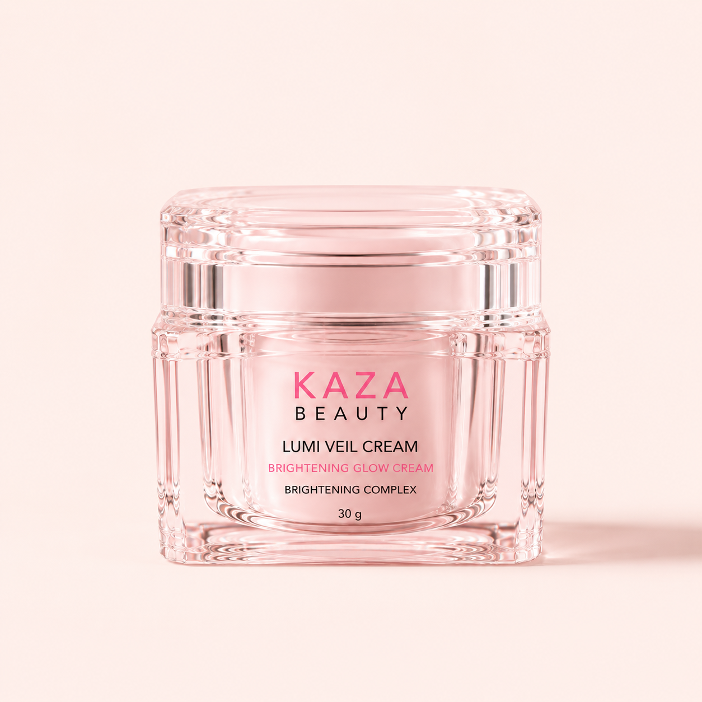

| Field | Value |
|---|---|
| Product ID | `KZ-10` |
| Name on live site | Kaza Beauty Lumi Veil Cream |
| Category | Skincare › Moisturiser |
| Site collection(s) | Skincare |
| Price | Rs. 999.00 (Taxes included; shipping calculated at checkout) |
| Status on site (2026-11-09) | **Sold out** |
| Size / net quantity | **30 g** — _source: Printed on jar (image 01)_ |
| Shades / options | 1 — Single variant |
| Packaging | Heavy clear-pink faceted acrylic jar with chrome-banded lid. |
| Pack & site claims | Brightening Glow Cream, Brightening Complex, Dewy finish, For all skin types |
| Key ingredients | Brightening Complex (as printed on pack) |
| Live URL | <https://kaza-beauty.com/products/kaza-beauty-lumi-veil-cream> |
| Shopify product ID / handle | `9669979013361` / `kaza-beauty-lumi-veil-cream` |
| Product folder | `products/skincare/KZ-10_lumi-veil-cream/` |

**Description (verbatim from live site):**

> Kaza Beauty Lumi Veil Cream is a lightweight, luminous moisturizer designed to enhance your skin's natural radiance. Infused with nourishing ingredients, this veil cream creates a smooth, dewy finish while providing essential hydration throughout the day. Perfect for all skin types, it glides effortlessly onto the skin, leaving a soft, luminescent glow. Use morning and night as part of your skincare routine for visibly brighter, more radiant skin.

**Shades / variants**

| # | Shade (clean name) | Name on site | Name on pack / shade card | Colour description | Price | Available | Shade image |
|---|---|---|---|---|---|---|---|
| 1 | **Single variant** | Default Title | - | Single variant | Rs. 999 | No (sold out) | — |

**Images**

| # | Role | Shade | What it shows | File | Size (px) |
|---|---|---|---|---|---|
| 01 | hero-packshot | — | Hero packshot: closed jar - Lumi Veil Cream, Brightening Glow Cream, Brightening Complex, 30 g. | [kaza_lumi-veil-cream_01_hero-packshot.png](products/skincare/KZ-10_lumi-veil-cream/images/kaza_lumi-veil-cream_01_hero-packshot.png) | 1254×1254 |
| 02 | before-after | — | Before / After model with open jar. | [kaza_lumi-veil-cream_02_before-after.jpg](products/skincare/KZ-10_lumi-veil-cream/images/kaza_lumi-veil-cream_02_before-after.jpg) | 2048×2048 |
| 03 | model-lifestyle | — | Campaign: model applying cream to cheek, open jar, pink florals. | [kaza_lumi-veil-cream_03_model-lifestyle.jpg](products/skincare/KZ-10_lumi-veil-cream/images/kaza_lumi-veil-cream_03_model-lifestyle.jpg) | 2048×2048 |
| 04 | lifestyle-packshot | — | Lifestyle packshot: open jar with lid, pink florals. | [kaza_lumi-veil-cream_04_lifestyle-packshot.png](products/skincare/KZ-10_lumi-veil-cream/images/kaza_lumi-veil-cream_04_lifestyle-packshot.png) | 1254×1254 |

---

### KZ-11 · Kaza Beauty Cloud Cream Moisturiser

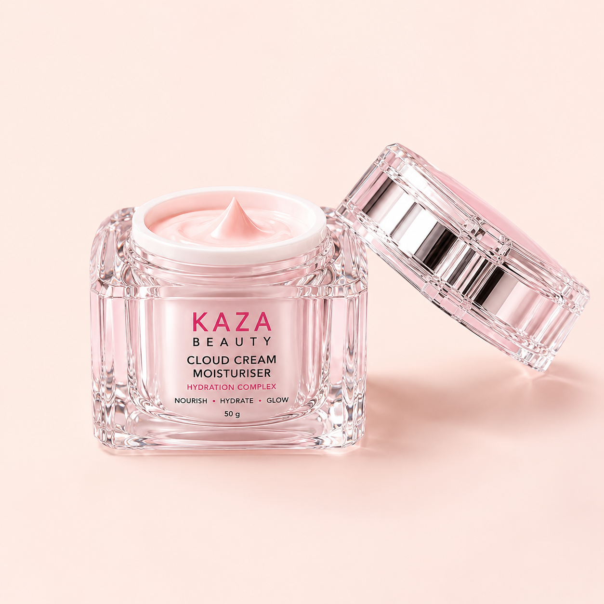

| Field | Value |
|---|---|
| Product ID | `KZ-11` |
| Name on live site | Kaza beauty Cloud Cream |
| Category | Skincare › Moisturiser |
| Site collection(s) | Skincare |
| Price | Rs. 1,199.00 (Taxes included; shipping calculated at checkout) |
| Status on site (2026-11-09) | **Sold out** |
| Size / net quantity | **50 g** — _source: Printed on jar (image 01); site shipping weight 100 g_ |
| Shades / options | 1 — Single variant |
| Packaging | Clear-pink faceted acrylic jar, chrome-banded lid. |
| Pack & site claims | Hydration Complex, Nourish - Hydrate - Glow, Lightweight, non-greasy, Suitable for all skin types |
| Key ingredients | Hydration Complex (as printed on pack) |
| Live URL | <https://kaza-beauty.com/products/kaza-beauty-cloud-cream> |
| Shopify product ID / handle | `9671641006321` / `kaza-beauty-cloud-cream` |
| Product folder | `products/skincare/KZ-11_cloud-cream/` |

**Description (verbatim from live site):**

> Kaza Beauty Cloud Cream Moisturiser is a lightweight, deeply hydrating face cream designed to nourish dry, dull and tired-looking skin. Powered by a moisture-rich hydration complex, it helps strengthen the skin barrier, improve softness and lock in long-lasting hydration without feeling heavy or greasy.
> 
> Its smooth, cloud-like texture absorbs effortlessly, leaving skin plump, comfortable and naturally radiant. Suitable for all skin types and ideal for everyday use.

**Shades / variants**

| # | Shade (clean name) | Name on site | Name on pack / shade card | Colour description | Price | Available | Shade image |
|---|---|---|---|---|---|---|---|
| 1 | **Single variant** | Default Title | - | Single variant | Rs. 1,199 | No (sold out) | — |

**Images**

| # | Role | Shade | What it shows | File | Size (px) |
|---|---|---|---|---|---|
| 01 | hero-packshot | — | Hero packshot: open jar with lid - Cloud Cream Moisturiser, Hydration Complex, Nourish - Hydrate - Glow, 50 g. | [kaza_cloud-cream_01_hero-packshot.png](products/skincare/KZ-11_cloud-cream/images/kaza_cloud-cream_01_hero-packshot.png) | 1254×1254 |

---

### KZ-12 · Kaza Beauty Lip Balm

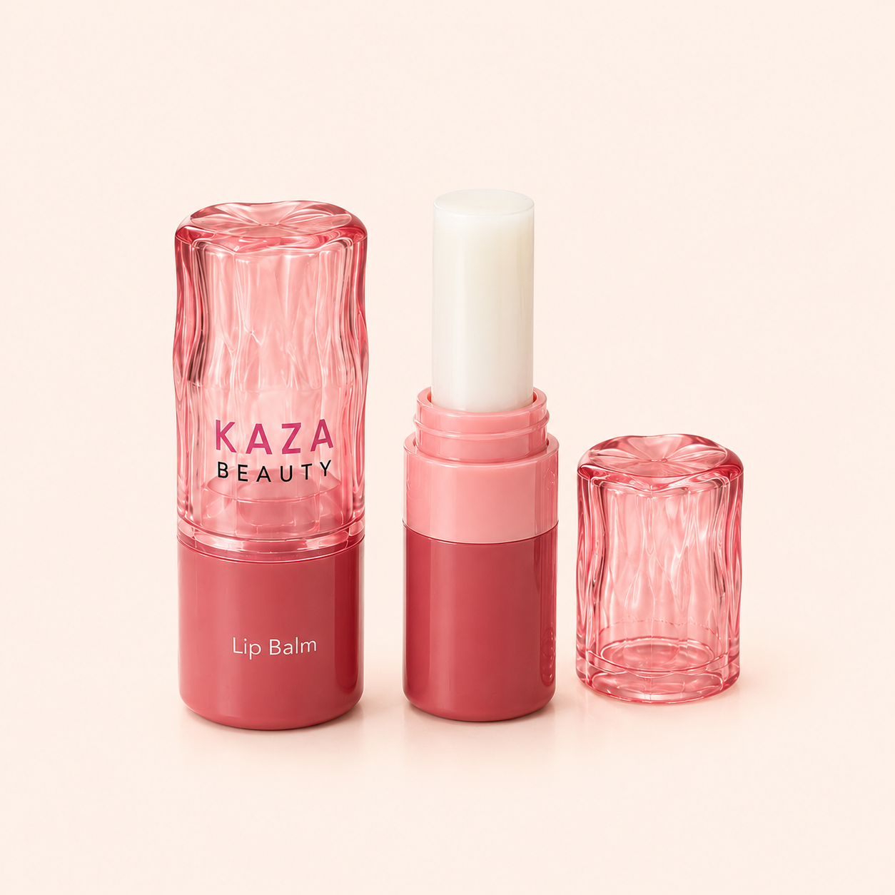

| Field | Value |
|---|---|
| Product ID | `KZ-12` |
| Name on live site | Lip Balm |
| Category | Skincare › Lip Care |
| Site collection(s) | Skincare |
| Price | Rs. 499.00 (Taxes included; shipping calculated at checkout) |
| Status on site (2026-11-09) | **Sold out** |
| Size / net quantity | **4 g / 0.14 oz** — _source: Printed on carton (image 02)_ |
| Shades / options | 4 — Petal Melt, Bare Bloom (Clear), Strawberry Sorbet, Peach Bellini |
| Packaging | Rose-pink bullet with faceted clear-pink crystal cap; pink carton. |
| Pack & site claims | Vegan, Cruelty Free, Paraben Free, Nourishing, Hydrating, Smooth & Glossy, Perfect for daily use |
| Key ingredients | Not listed on site or pack |
| Live URL | <https://kaza-beauty.com/products/lip-balm> |
| Shopify product ID / handle | `9669978063089` / `lip-balm` |
| Product folder | `products/skincare/KZ-12_lip-balm/` |

**Description (verbatim from live site):**

> Nourish and protect your lips with our premium Lip Balm. Formulated with natural moisturizers and soothing ingredients, this balm delivers long-lasting hydration and softness. Perfect for daily use, it shields lips from dryness and environmental stress while leaving them smooth and supple. Slip it into your pocket or bag for on-the-go lip care anytime, anywhere.

**Other marketing copy:** "Nourish. Hydrate. Shine. For lips that care." · "Soft. Smooth. Beautifully Balanced."

**Shades / variants**

| # | Shade (clean name) | Name on site | Name on pack / shade card | Colour description | Price | Available | Shade image |
|---|---|---|---|---|---|---|---|
| 1 | **Petal Melt** | Petal Melt | - | Not shown in images | Rs. 499 | No (sold out) | — |
| 2 | **Bare Bloom (Clear)** | Bare Bloom (clear) | - | Clear (per name); not shown in images | Rs. 499 | No (sold out) | — |
| 3 | **Strawberry Sorbet** | strawberry sorbet | - | Not shown in images | Rs. 499 | No (sold out) | — |
| 4 | **Peach Bellini** | Peach belini | - | Not shown in images | Rs. 499 | No (sold out) | — |

**Images**

| # | Role | Shade | What it shows | File | Size (px) |
|---|---|---|---|---|---|
| 01 | hero-packshot | — | Hero packshot: balm bullet uncapped + crystal cap. | [kaza_lip-balm_01_hero-packshot.png](products/skincare/KZ-12_lip-balm/images/kaza_lip-balm_01_hero-packshot.png) | 1254×1254 |
| 02 | infographic | — | Infographic: Before (dry, dull & chapped lips) / After (soft, smooth & glossy); benefits Nourishing, Hydrating, Smooth & Glossy, Perfect for daily use; Vegan / Cruelty Free / Paraben Free; carton 4 g / 0.14 oz. | [kaza_lip-balm_02_infographic.png](products/skincare/KZ-12_lip-balm/images/kaza_lip-balm_02_infographic.png) | 1080×1080 |
| 03 | lifestyle-packshot | — | Lifestyle packshot on marble with roses: "Soft. Smooth. Beautifully Balanced. For lips that care." | [kaza_lip-balm_03_lifestyle-packshot.png](products/skincare/KZ-12_lip-balm/images/kaza_lip-balm_03_lifestyle-packshot.png) | 1080×1080 |
| 04 | model-lifestyle | — | Campaign: model with balm + carton: "Nourish. Hydrate. Shine." | [kaza_lip-balm_04_model-lifestyle.png](products/skincare/KZ-12_lip-balm/images/kaza_lip-balm_04_model-lifestyle.png) | 1080×1080 |

---

## 6. Brand & campaign assets

| ID | Type | Where it is used | What it shows | Products featured | File |
|---|---|---|---|---|---|
| BA-01 | Logo | Header | Primary wordmark: "KAZA" in pink (#F0559F) + "BEAUTY" in black (#0B0B0B), transparent background. | — | [kaza_logo_wordmark_pink-black.png](brand_assets/logos/kaza_logo_wordmark_pink-black.png) |
| BA-02 | Logo | Not placed in a homepage section (site icon / social avatar) | Monogram: white "K" in pink circle (#F93B7B) on black. | — | [kaza_logo_monogram-k_pink-circle.png](brand_assets/logos/kaza_logo_monogram-k_pink-circle.png) |
| BA-03 | Website homepage image | Hero banner (hero_iLBwPd) | Five diverse models holding lip gloss, cushion compact and lip & cheek tint. | KZ-02; KZ-06; KZ-04 | [kaza_home_01_hero_five-models-group.jpg](brand_assets/website_homepage/kaza_home_01_hero_five-models-group.jpg) |
| BA-04 | Website homepage image | Hero banner (hero_baFhFr) | Model with bold red lip biting the KAZA kajal pencil, red background. | KZ-07 | [kaza_home_02_hero_model-biting-kajal-red.png](brand_assets/website_homepage/kaza_home_02_hero_model-biting-kajal-red.png) |
| BA-05 | Website homepage image | Slideshow (slideshow_i9xKKp) | Three women smiling warmly, neutral tops - brand/community imagery. | — | [kaza_home_03_slideshow_three-models-smiling.jpg](brand_assets/website_homepage/kaza_home_03_slideshow_three-models-smiling.jpg) |
| BA-06 | Website homepage image | Slideshow "Clear Code Serum - Clear pores. Control oil. Reveal your glow." (slideshow_x38Aa7) | Model in pink/burgundy checkerboard room with oversized Clear Code Serum bottles. | KZ-09 | [kaza_home_04_slideshow_clear-code-serum-checkerboard.png](brand_assets/website_homepage/kaza_home_04_slideshow_clear-code-serum-checkerboard.png) |
| BA-07 | Website homepage image | Media with content (media_with_content_RqxiU3) | Model winking, tongue out, holding a KAZA serum bottle, white background. | KZ-09 / KZ-08 | [kaza_home_05_media_model-winking-with-serum.png](brand_assets/website_homepage/kaza_home_05_media_model-winking-with-serum.png) |
| BA-08 | Website homepage image | Custom section (section_iXjGDa) | Two models in pink holding KAZA lip gloss tubes, peach background. | KZ-02 | [kaza_home_06_section_two-models-lip-gloss.png](brand_assets/website_homepage/kaza_home_06_section_two-models-lip-gloss.png) |
| BA-09 | Website homepage image | Featured product - Liquid Matte Lipstick (featured_product_BFKVmp) | Model playfully applying liquid lipstick from the KAZA tube. | KZ-01 | [kaza_home_07_featured_liquid-matte-lipstick-model.jpg](brand_assets/website_homepage/kaza_home_07_featured_liquid-matte-lipstick-model.jpg) |
| BA-10 | Website homepage image | Featured product - Lip and Cheek Tint (featured_product_nxXQFE) | Model with coral flushed cheeks holding the tint pot. | KZ-04 | [kaza_home_08_featured_lip-cheek-tint-model.jpg](brand_assets/website_homepage/kaza_home_08_featured_lip-cheek-tint-model.jpg) |
| BA-11 | Website homepage image | Media with content (media_with_content_jb3c8T) | Model in pink jacket reaching toward an oversized tint pot, blue room. | KZ-04 | [kaza_home_09_media_lip-cheek-tint-blue-room.png](brand_assets/website_homepage/kaza_home_09_media_lip-cheek-tint-blue-room.png) |
| BA-12 | Website homepage image | Creator Club banner (section_DMhTyU) | "KAZA Creator Club - YOU + KAZA? kinda iconic. Create. Get gifted. Earn. Grow. Join the Creator Club - no minimum followers." Shows Glow C Serum, Lip Oil, Lip Gloss, Lip Balm. | KZ-08; KZ-03; KZ-02; KZ-12 | [kaza_home_10_creator-club-banner.png](brand_assets/website_homepage/kaza_home_10_creator-club-banner.png) |
| BA-13 | Website homepage image | Referenced in homepage code (lazy-loaded / no section id found) | Model in pink peony field hugging an oversized Lumi Veil Cream jar. | KZ-10 | [kaza_home_11_lumi-veil-cream-flower-field.png](brand_assets/website_homepage/kaza_home_11_lumi-veil-cream-flower-field.png) |
| BA-14 | Creator-site render (GitHub repo kaza-creator-sparkle) | kaza-creator-sparkle: src/components/kaza/hero.tsx | Generic render used on creator landing page hero (not actual KAZA packaging). | — | [kaza_creator-site_render_blush-compact.png](brand_assets/creator_site_renders/kaza_creator-site_render_blush-compact.png) |
| BA-15 | Creator-site render (GitHub repo kaza-creator-sparkle) | kaza-creator-sparkle: src/components/kaza/hero.tsx | Generic render used on creator landing page hero (not actual KAZA packaging). | — | [kaza_creator-site_render_lip-oil.png](brand_assets/creator_site_renders/kaza_creator-site_render_lip-oil.png) |
| BA-16 | Creator-site render (GitHub repo kaza-creator-sparkle) | kaza-creator-sparkle: src/components/kaza/hero.tsx | Generic render used on creator landing page hero (not actual KAZA packaging). | — | [kaza_creator-site_render_lipstick.png](brand_assets/creator_site_renders/kaza_creator-site_render_lipstick.png) |
| BA-17 | Creator-site render (GitHub repo kaza-creator-sparkle) | kaza-creator-sparkle: src/components/kaza/hero.tsx | Generic pink swatch render used on creator landing page hero. | — | [kaza_creator-site_render_pink-swatch.png](brand_assets/creator_site_renders/kaza_creator-site_render_pink-swatch.png) |

## 7. Store policies

- **Shipping:** Shipping within 2-5 business days (India only)
- **Returns:** 30-day return policy; unused, original packaging, proof of purchase; start by emailing aquilastudio@gmail.com
- **Contact:** aquilastudio@gmail.com
- Full policy text: `source_snapshot_2026-11-09/store_pages/`

## 8. Data issues found on the live site

_Recorded for the team to review. Nothing on the live site was changed._

| Scope | Type | Issue |
|---|---|---|
| All products | Availability | All 12 products show "Sold out" (available = false) on the live site at capture time. |
| All products | Data completeness | No SKU, barcode, product type or tags set on any product/variant. |
| All products | Net quantity | Net quantity/size is not stated anywhere in product text; it is only visible on packaging images. Variant weights are 0 except Cloud Cream (100 g). |
| All products | Page content | Product page tabs "Made with care / Details / Shipping & Returns" contain generic theme placeholder text, identical on every product. |
| All products | Accessibility/SEO | 45 of 47 product images have no alt text; most image files keep AI-tool/screenshot export names. |
| KZ-05 Blush Stick | Missing data | No description; no shade variants even though 5 different colours are shown in images; not in any collection (not reachable from Makeup/Skincare menus). |
| KZ-06 Cushion Foundation | Mismatch | URL handle is "kaza-beauty-compact"; title has a double space ("Kaza  Cushion Foundation"); description describes a "contour powder"/"Kaza Beauty Compact"; images show a pressed-powder compact. |
| KZ-06 Cushion Foundation | Shade naming | Shade "Pearl Viel" likely meant "Pearl Veil"; "Warm nude" capitalisation. Variant images are named after other shades (Pearl Viel -> "Ivory_silk" file, Ivory Silk -> "Vanilla_Beige" file, Warm nude -> "warm_sand" file) - confirm mapping. |
| KZ-04 Lip & Cheek Tint | Mismatch | Handle "kaza-beauty-cream-blush"; description calls it "Cream Blush" and is cut off mid-sentence ("...a bold pop of color, this"). Site shade names (Bare Bloom (clear) / peach kiss / Berry Glaze) differ from the shade cards (Bloom pH / Peach Kiss / Berry Bloom). No images are linked to variants. Images are low-res screenshots (~600 px). |
| KZ-09 Clear Code Serum | Naming | URL handle is "kaza-beauty-lip-gloss-1" (copied from Lip Gloss); title "Clear code serum" lower-case. |
| KZ-02 Lip Gloss | Shade naming | Variant "Clear Glass" is called "Glass Affair" on the shade card and image file. |
| KZ-01 Liquid Matte Lipstick | Shade naming | "Terracota Heat" misspelled (pack/shade sheet: "Terracotta Heat"); "Plum obsession" capitalisation. |
| KZ-12 Lip Balm | Naming | Title lacks "Kaza Beauty"; shades "strawberry sorbet" and "Peach belini" (Bellini) spelling/capitalisation; no shade images for any of the 4 shades; listed under Skincare collection. |
| KZ-07 Kajal | Variant gap | "Brown Muse - Rich Brown" shown in image 02 but not sold as a variant; image alt text says "Midnight Mousse eyeliner". |
| KZ-11 Cloud Cream / KZ-04 | Naming | Titles use lower-case "Kaza beauty" (inconsistent with "Kaza Beauty"). |
| KZ-11 Cloud Cream | Size mismatch | Pack shows 50 g; site shipping weight is 100 g (may be gross/shipping weight). |
| Store policies | Placeholder | Refund policy still contains "[INSERT RETURN ADDRESS]"; contact page lists only email aquilastudio@gmail.com and address "India" (no phone, VAT/trade number blank). |

## 9. Sources & method

- Live store https://kaza-beauty.com (Shopify public JSON feeds `/products.json`, `/products/<handle>.js`, `/collections/*`, `/meta.json`, plus product, home and policy pages), read-only, on 2026-11-09.
- GitHub repo `reserveautomation-ux/kaza-creator-sparkle` (Creator Club landing page) — read only; contributed 4 generic renders, no catalogue data. Repo `reserveautomation-ux/kaza` was empty.
- Sizes, claims, shade-card names and ingredients marked "pack" were read from text printed on the product images. Colour descriptions marked "observed" are visual descriptions, not official names.
- Images are the original full-resolution files from the Shopify CDN, renamed only. Original filenames and URLs are kept in `data/kaza_images.csv` and the Excel **Images** sheet.
