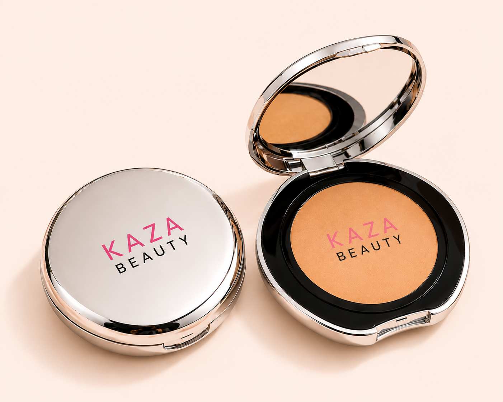

# Kaza Beauty Cushion Foundation

_KAZA Beauty product sheet · captured from https://kaza-beauty.com on 2026-11-09 · back to [Brand Bible](../../../KAZA_Brand_Bible.md)_

| Field | Value |
|---|---|
| Product ID | `KZ-06` |
| Name on live site | Kaza  Cushion Foundation |
| Category | Makeup › Face / Complexion |
| Site collection(s) | Makeup |
| Price | Rs. 1,099.00 (Taxes included; shipping calculated at checkout) |
| Status on site (2026-11-09) | **Sold out** |
| Size / net quantity | **Not stated** — _source: Not stated on site or visible on pack_ |
| Shades / options | 4 — Pearl Veil, Ivory Silk, Cashmere Beige, Warm Nude |
| Packaging | Round chrome compact with mirror lid, black inner pan ring, KAZA BEAUTY in pink on lid and pressed into product. |
| Pack & site claims | Buildable coverage, For all skin tones and types (per site copy) |
| Key ingredients | Not listed on site or pack |
| Live URL | <https://kaza-beauty.com/products/kaza-beauty-compact> |
| Shopify product ID / handle | `9669987238129` / `kaza-beauty-compact` |
| Product folder | `products/makeup/KZ-06_cushion-foundation/` |

**Description (verbatim from live site):**

> Achieve a sculpted, defined look with Kaza Beauty Compact. This versatile contour powder blends seamlessly into skin, creating natural shadows and dimension. Perfect for contouring, bronzing, or subtle shading, it delivers buildable coverage with a smooth, long-lasting finish. Ideal for all skin tones and types.

**Shades / variants**

| # | Shade (clean name) | Name on site | Name on pack / shade card | Colour description | Price | Available | Shade image |
|---|---|---|---|---|---|---|---|
| 1 | **Pearl Veil** | Pearl Viel | - | Lightest - fair ivory (image file named "Ivory silk") | Rs. 1,099 | No (sold out) | [kaza_cushion-foundation_02_shade-packshot_pearl-veil.jpg](images/kaza_cushion-foundation_02_shade-packshot_pearl-veil.jpg) |
| 2 | **Ivory Silk** | Ivory Silk | - | Light beige (image file named "Vanilla Beige") | Rs. 1,099 | No (sold out) | [kaza_cushion-foundation_03_shade-packshot_ivory-silk.jpg](images/kaza_cushion-foundation_03_shade-packshot_ivory-silk.jpg) |
| 3 | **Cashmere Beige** | Cashmere Beige | - | Medium golden beige | Rs. 1,099 | No (sold out) | [kaza_cushion-foundation_01_hero-packshot_cashmere-beige.png](images/kaza_cushion-foundation_01_hero-packshot_cashmere-beige.png) |
| 4 | **Warm Nude** | Warm nude | - | Tan / warm sand (image file named "warm sand") | Rs. 1,099 | No (sold out) | [kaza_cushion-foundation_04_shade-packshot_warm-nude.jpg](images/kaza_cushion-foundation_04_shade-packshot_warm-nude.jpg) |

**Images**

| # | Role | Shade | What it shows | File | Size (px) |
|---|---|---|---|---|---|
| 01 | hero-packshot | Cashmere Beige | Hero packshot: closed + open compact, medium golden shade. | [kaza_cushion-foundation_01_hero-packshot_cashmere-beige.png](images/kaza_cushion-foundation_01_hero-packshot_cashmere-beige.png) | 1402×1122 |
| 02 | shade-packshot | Pearl Veil | Shade packshot: open + closed compact with powder swatch, lightest shade (file name "Ivory silk"). | [kaza_cushion-foundation_02_shade-packshot_pearl-veil.jpg](images/kaza_cushion-foundation_02_shade-packshot_pearl-veil.jpg) | 2048×2048 |
| 03 | shade-packshot | Ivory Silk | Shade packshot: closed + open compact, light beige (file name "Vanilla Beige"). | [kaza_cushion-foundation_03_shade-packshot_ivory-silk.jpg](images/kaza_cushion-foundation_03_shade-packshot_ivory-silk.jpg) | 2048×2048 |
| 04 | shade-packshot | Warm Nude | Shade packshot: closed + open compact, tan/warm shade (file name "warm sand"). | [kaza_cushion-foundation_04_shade-packshot_warm-nude.jpg](images/kaza_cushion-foundation_04_shade-packshot_warm-nude.jpg) | 2048×2048 |
