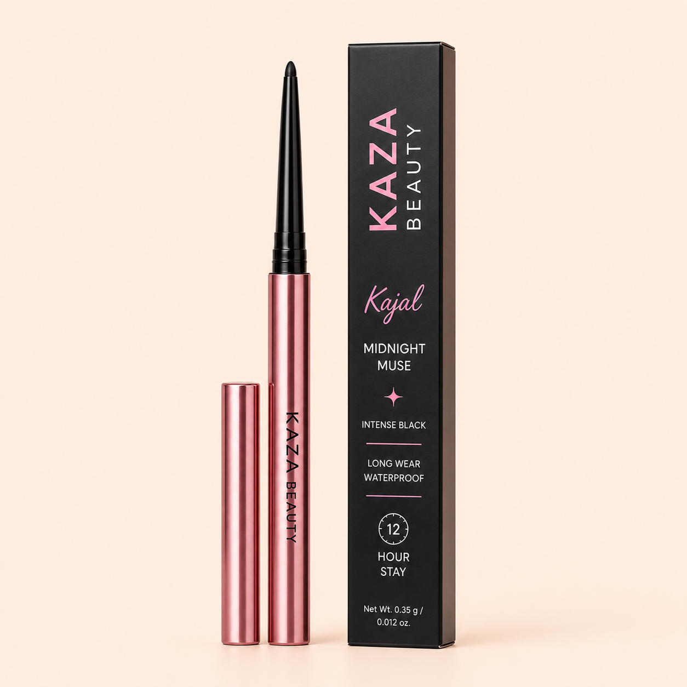

# Kaza Beauty Kajal - Midnight Muse

_KAZA Beauty product sheet · captured from https://kaza-beauty.com on 2026-11-09 · back to [Brand Bible](../../../KAZA_Brand_Bible.md)_

| Field | Value |
|---|---|
| Product ID | `KZ-07` |
| Name on live site | Kaza Beauty Kajal |
| Category | Makeup › Eyes |
| Site collection(s) | Home page (featured), Makeup |
| Price | Rs. 499.00 (Taxes included; shipping calculated at checkout) |
| Status on site (2026-11-09) | **Sold out** |
| Size / net quantity | **Net Wt. 0.35 g / 0.012 oz** — _source: Printed on carton (image 01)_ |
| Shades / options | 1 — Midnight Muse (Intense Black) |
| Packaging | Rose-gold retractable pencil with cap; matte black carton with pink KAZA BEAUTY and script "Kajal". |
| Pack & site claims | Intense Black, Long Wear, Waterproof, 12 Hour Stay, Smudge-proof (site copy) |
| Key ingredients | Not listed on site or pack |
| Live URL | <https://kaza-beauty.com/products/kaza-beauty-kajal-midnight-muse-kajal> |
| Shopify product ID / handle | `9669977178353` / `kaza-beauty-kajal-midnight-muse-kajal` |
| Product folder | `products/makeup/KZ-07_kajal/` |

> Extra shade shown in images but **not sold**: Brown Muse - Rich Brown (image 02; NOT sold as a variant).

**Description (verbatim from live site):**

> Kaza Beauty Kajal Midnight Muse delivers intense, long-lasting color that defines your eyes with precision. This smooth, creamy kajal glides effortlessly along the lash line and waterline, creating bold definition that lasts all day and night. The rich midnight shade complements all skin tones, adding depth and drama to your gaze. Perfect for everyday wear or special occasions, this kajal combines comfort with stunning results. Easy to apply and smudge-proof, it's your go-to for captivating eyes.

**Other marketing copy:** Homepage featured product · Campaign: model biting the kajal pencil (homepage hero)

**Shades / variants**

| # | Shade (clean name) | Name on site | Name on pack / shade card | Colour description | Price | Available | Shade image |
|---|---|---|---|---|---|---|---|
| 1 | **Midnight Muse (Intense Black)** | Default Title | Midnight Muse - Intense Black | Intense black | Rs. 499 | No (sold out) | — |

**Images**

| # | Role | Shade | What it shows | File | Size (px) |
|---|---|---|---|---|---|
| 01 | hero-packshot | Midnight Muse | Hero packshot: Midnight Muse (Intense Black) pencil + cap + carton: Long Wear Waterproof, 12 Hour Stay, Net Wt. 0.35 g / 0.012 oz. | [kaza_kajal_01_hero-packshot_midnight-muse.png](images/kaza_kajal_01_hero-packshot_midnight-muse.png) | 1254×1254 |
| 02 | shade-packshot | Brown Muse | Packshot: Brown Muse (Rich Brown) pencil + carton - shade shown but not offered as a variant. | [kaza_kajal_02_shade-packshot_brown-muse.png](images/kaza_kajal_02_shade-packshot_brown-muse.png) | 1254×1254 |
| 03 | before-after | — | Before / After model: graphic winged black kajal look. | [kaza_kajal_03_before-after.jpg](images/kaza_kajal_03_before-after.jpg) | 2048×2048 |
| 04 | before-after | — | Before / After model: soft smudged brown kajal look. | [kaza_kajal_04_before-after.png](images/kaza_kajal_04_before-after.png) | 1254×1254 |
