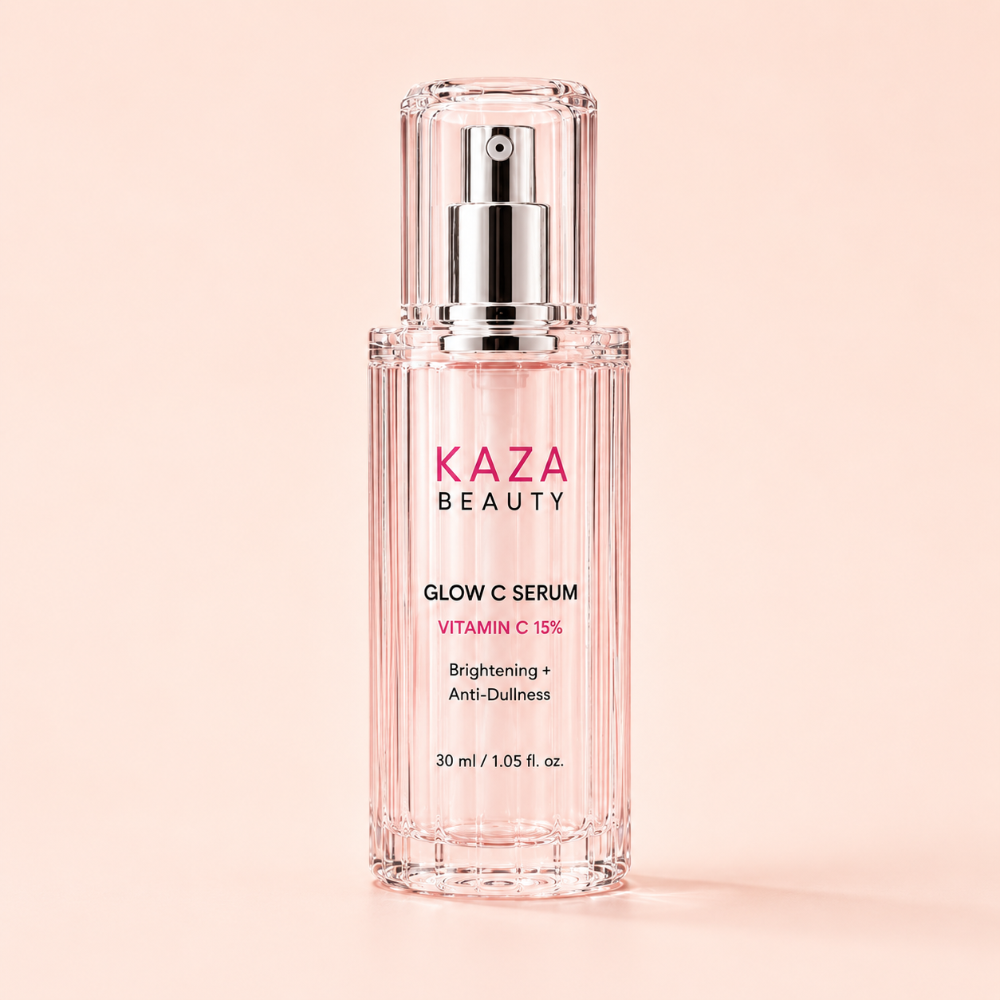

# Kaza Beauty Glow C Serum

_KAZA Beauty product sheet · captured from https://kaza-beauty.com on 2026-11-09 · back to [Brand Bible](../../../KAZA_Brand_Bible.md)_

| Field | Value |
|---|---|
| Product ID | `KZ-08` |
| Name on live site | Kaza Beauty Glow C Serum |
| Category | Skincare › Serum |
| Site collection(s) | Skincare |
| Price | Rs. 1,099.00 (Taxes included; shipping calculated at checkout) |
| Status on site (2026-11-09) | **Sold out** |
| Size / net quantity | **30 ml / 1.05 fl oz** — _source: Printed on bottle (images 01, 02)_ |
| Shades / options | 1 — Single variant |
| Packaging | Faceted clear-pink glass bottle with chrome pump and clear overcap. |
| Pack & site claims | Vitamin C 15%, Brightening + Anti-Dullness, Powerful antioxidant, For all skin types, Non-greasy |
| Key ingredients | Vitamin C 15% - brightens & boosts natural glow; Ferulic Acid - enhances antioxidant protection; Hyaluronic Acid - hydrates & plumps skin; Panthenol - soothes & strengthens skin barrier |
| Live URL | <https://kaza-beauty.com/products/kaza-beauty-glow-c-serum> |
| Shopify product ID / handle | `9670009258225` / `kaza-beauty-glow-c-serum` |
| Product folder | `products/skincare/KZ-08_glow-c-serum/` |

**Description (verbatim from live site):**

> Kaza Beauty Glow C Serum is a lightweight, fast-absorbing facial serum formulated to brighten and revitalize your complexion. Enriched with vitamin C and potent antioxidants, this serum helps reduce the appearance of dark spots, uneven skin tone, and fine lines while promoting a radiant, youthful glow. Perfect for all skin types, it absorbs quickly without leaving a greasy residue. Apply a few drops to clean skin each morning and evening for best results. Unlock your skin's natural luminosity with this essential skincare staple.

**Other marketing copy:** "For radiant, glowing skin" · "3 Modes. 3 Glow Benefits." - Brighten / Hydrate / Protect

**Shades / variants**

| # | Shade (clean name) | Name on site | Name on pack / shade card | Colour description | Price | Available | Shade image |
|---|---|---|---|---|---|---|---|
| 1 | **Single variant** | Default Title | - | Single variant | Rs. 1,099 | No (sold out) | — |

**Images**

| # | Role | Shade | What it shows | File | Size (px) |
|---|---|---|---|---|---|
| 01 | hero-packshot | — | Hero packshot: Glow C Serum bottle, Vitamin C 15%, Brightening + Anti-Dullness, 30 ml / 1.05 fl oz. | [kaza_glow-c-serum_01_hero-packshot.png](images/kaza_glow-c-serum_01_hero-packshot.png) | 1254×1254 |
| 02 | infographic | — | Infographic: benefits (Brightens Skin, Anti-Dullness, Powerful Antioxidant), key ingredients (Vitamin C 15%, Ferulic Acid, Hyaluronic Acid, Panthenol), "3 Modes: Brighten / Hydrate / Protect". | [kaza_glow-c-serum_02_infographic.png](images/kaza_glow-c-serum_02_infographic.png) | 1080×1080 |
| 03 | before-after | — | Before / After model with bottle, "For radiant, glowing skin". | [kaza_glow-c-serum_03_before-after.png](images/kaza_glow-c-serum_03_before-after.png) | 1080×1080 |
