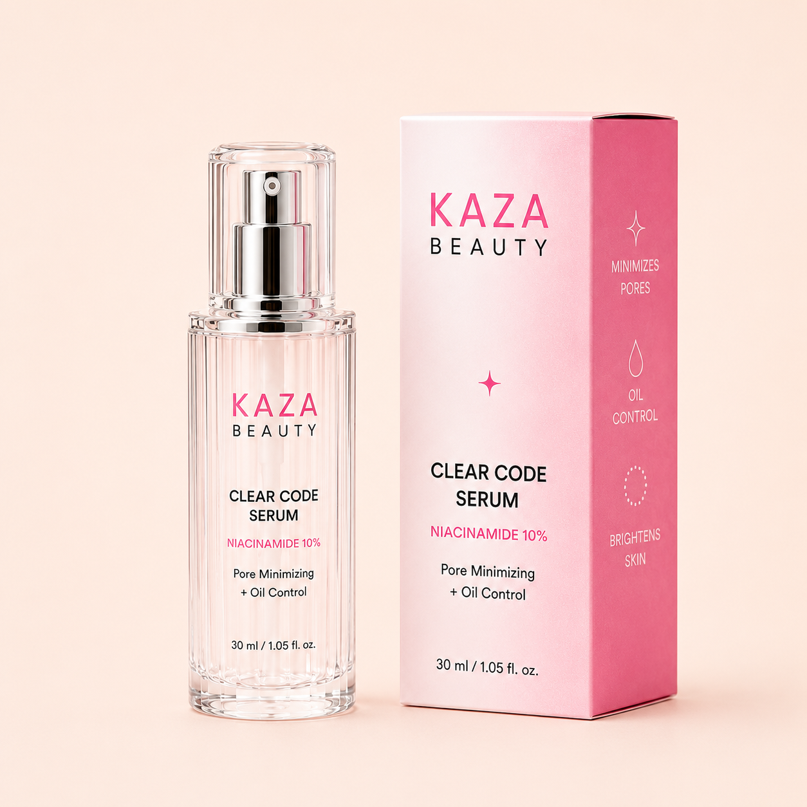

# Kaza Beauty Clear Code Serum

_KAZA Beauty product sheet · captured from https://kaza-beauty.com on 2026-11-09 · back to [Brand Bible](../../../KAZA_Brand_Bible.md)_

| Field | Value |
|---|---|
| Product ID | `KZ-09` |
| Name on live site | Kaza Beauty Clear code serum |
| Category | Skincare › Serum |
| Site collection(s) | Skincare |
| Price | Rs. 1,299.00 (Taxes included; shipping calculated at checkout) |
| Status on site (2026-11-09) | **Sold out** |
| Size / net quantity | **30 ml / 1.05 fl oz** — _source: Printed on bottle + carton (image 01)_ |
| Shades / options | 1 — Single variant |
| Packaging | Fluted clear bottle with chrome pump and clear overcap; pink gradient carton. |
| Pack & site claims | Niacinamide 10%, Pore Minimizing + Oil Control, Minimizes Pores, Oil Control, Brightens Skin, Lightweight, non-greasy |
| Key ingredients | Niacinamide 10% |
| Live URL | <https://kaza-beauty.com/products/kaza-beauty-lip-gloss-1> |
| Shopify product ID / handle | `9670129942769` / `kaza-beauty-lip-gloss-1` |
| Product folder | `products/skincare/KZ-09_clear-code-serum/` |

**Description (verbatim from live site):**

> Kaza Beauty Clear Code Serum is a lightweight, fast-absorbing niacinamide serum designed to help refine the look of pores, control excess oil and improve uneven-looking skin. Powered by 10% niacinamide, it supports a smoother, clearer and more balanced complexion without leaving the skin sticky or heavy.
> 
> With regular use, the serum helps reduce dullness, improve skin texture and maintain a fresh, shine-controlled finish. Its gentle everyday formula layers easily under moisturiser, sunscreen and makeup.
> 
> Key benefits:Minimises the appearance of pores • Controls excess oil • Brightens dull-looking skin • Smooths uneven texture • Lightweight and non-greasy
> 
> How to use: Apply 2–3 drops to clean, dry skin before moisturiser. Use once or twice daily, followed by sunscreen during the day.

**Other marketing copy:** Homepage slideshow: "Clear Code Serum - Clear pores. Control oil. Reveal your glow."

**Shades / variants**

| # | Shade (clean name) | Name on site | Name on pack / shade card | Colour description | Price | Available | Shade image |
|---|---|---|---|---|---|---|---|
| 1 | **Single variant** | Default Title | - | Single variant | Rs. 1,299 | No (sold out) | — |

**Images**

| # | Role | Shade | What it shows | File | Size (px) |
|---|---|---|---|---|---|
| 01 | hero-packshot | — | Hero packshot: bottle + carton, Niacinamide 10%, Pore Minimizing + Oil Control, 30 ml / 1.05 fl oz. | [kaza_clear-code-serum_01_hero-packshot.png](images/kaza_clear-code-serum_01_hero-packshot.png) | 1254×1254 |
