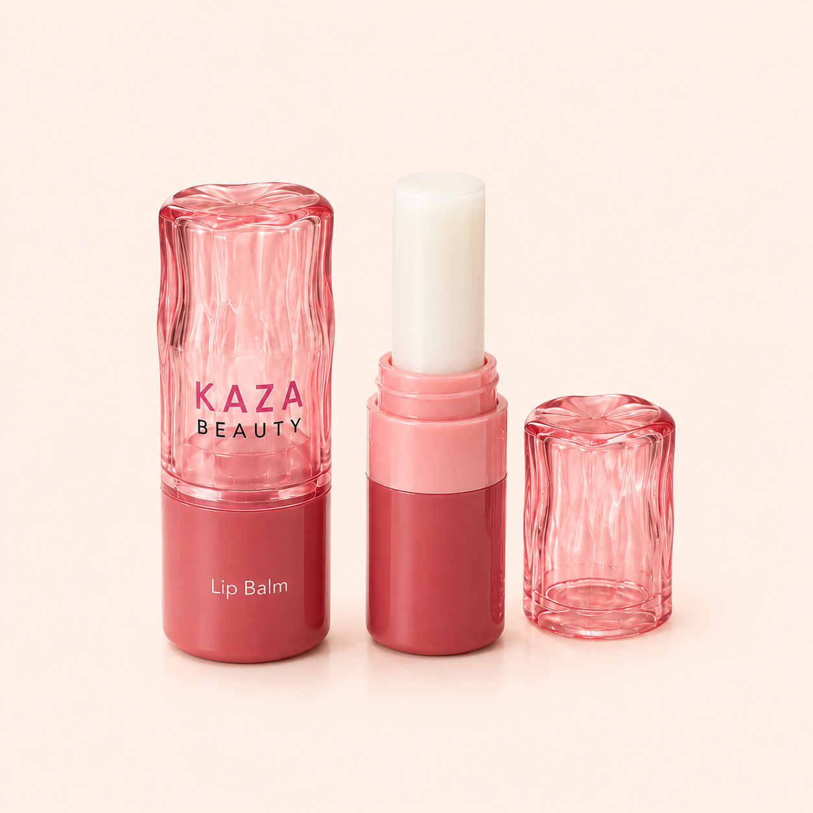

# Kaza Beauty Lip Balm

_KAZA Beauty product sheet · captured from https://kaza-beauty.com on 2026-11-09 · back to [Brand Bible](../../../KAZA_Brand_Bible.md)_

| Field | Value |
|---|---|
| Product ID | `KZ-12` |
| Name on live site | Lip Balm |
| Category | Skincare › Lip Care |
| Site collection(s) | Skincare |
| Price | Rs. 499.00 (Taxes included; shipping calculated at checkout) |
| Status on site (2026-11-09) | **Sold out** |
| Size / net quantity | **4 g / 0.14 oz** — _source: Printed on carton (image 02)_ |
| Shades / options | 4 — Petal Melt, Bare Bloom (Clear), Strawberry Sorbet, Peach Bellini |
| Packaging | Rose-pink bullet with faceted clear-pink crystal cap; pink carton. |
| Pack & site claims | Vegan, Cruelty Free, Paraben Free, Nourishing, Hydrating, Smooth & Glossy, Perfect for daily use |
| Key ingredients | Not listed on site or pack |
| Live URL | <https://kaza-beauty.com/products/lip-balm> |
| Shopify product ID / handle | `9669978063089` / `lip-balm` |
| Product folder | `products/skincare/KZ-12_lip-balm/` |

**Description (verbatim from live site):**

> Nourish and protect your lips with our premium Lip Balm. Formulated with natural moisturizers and soothing ingredients, this balm delivers long-lasting hydration and softness. Perfect for daily use, it shields lips from dryness and environmental stress while leaving them smooth and supple. Slip it into your pocket or bag for on-the-go lip care anytime, anywhere.

**Other marketing copy:** "Nourish. Hydrate. Shine. For lips that care." · "Soft. Smooth. Beautifully Balanced."

**Shades / variants**

| # | Shade (clean name) | Name on site | Name on pack / shade card | Colour description | Price | Available | Shade image |
|---|---|---|---|---|---|---|---|
| 1 | **Petal Melt** | Petal Melt | - | Not shown in images | Rs. 499 | No (sold out) | — |
| 2 | **Bare Bloom (Clear)** | Bare Bloom (clear) | - | Clear (per name); not shown in images | Rs. 499 | No (sold out) | — |
| 3 | **Strawberry Sorbet** | strawberry sorbet | - | Not shown in images | Rs. 499 | No (sold out) | — |
| 4 | **Peach Bellini** | Peach belini | - | Not shown in images | Rs. 499 | No (sold out) | — |

**Images**

| # | Role | Shade | What it shows | File | Size (px) |
|---|---|---|---|---|---|
| 01 | hero-packshot | — | Hero packshot: balm bullet uncapped + crystal cap. | [kaza_lip-balm_01_hero-packshot.png](images/kaza_lip-balm_01_hero-packshot.png) | 1254×1254 |
| 02 | infographic | — | Infographic: Before (dry, dull & chapped lips) / After (soft, smooth & glossy); benefits Nourishing, Hydrating, Smooth & Glossy, Perfect for daily use; Vegan / Cruelty Free / Paraben Free; carton 4 g / 0.14 oz. | [kaza_lip-balm_02_infographic.png](images/kaza_lip-balm_02_infographic.png) | 1080×1080 |
| 03 | lifestyle-packshot | — | Lifestyle packshot on marble with roses: "Soft. Smooth. Beautifully Balanced. For lips that care." | [kaza_lip-balm_03_lifestyle-packshot.png](images/kaza_lip-balm_03_lifestyle-packshot.png) | 1080×1080 |
| 04 | model-lifestyle | — | Campaign: model with balm + carton: "Nourish. Hydrate. Shine." | [kaza_lip-balm_04_model-lifestyle.png](images/kaza_lip-balm_04_model-lifestyle.png) | 1080×1080 |
